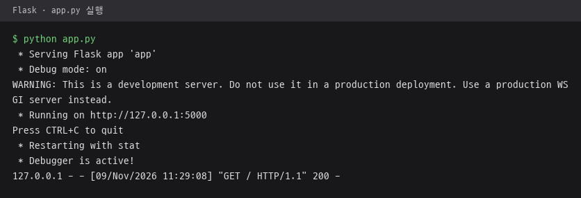

# Flask · 시작 예제

`/` 경로에 `Hello, World!` 문자열 하나만 응답하는 Flask 시작 예제.
저장소 전체 구성은 [저장소 README](../README.md) 참고.

## 파일

| 파일 | 역할 |
|---|---|
| [`app.py`](app.py) | `Flask(__name__)`로 앱 생성, `@app.route('/')`에 `hello_world()` 연결, 직접 실행 시 `app.run(debug=True)`로 개발 서버 실행 |

## 실행

```
pip install flask
cd Flask
python app.py
```

실행 후 브라우저에서 `http://127.0.0.1:5000/` 접속 시 `Hello, World!` 표시. Flask 개발 서버 기본 주소 사용.

## 실행 화면

`python app.py`로 개발 서버를 띄운 터미널과, 같은 주소를 브라우저로 연 화면. 디버거 PIN 줄은 사진에서 제외.




