# MakeListSet · 자료구조 구현과 응용

리스트·스택·큐·덱·우선순위 큐·집합을 파이썬 리스트와 클래스만으로 구현한 폴더.
구현한 구조를 괄호 검사, 수식 계산, 미로 탐색, 라인 편집에 적용하고, 같은 알고리즘을 Flet 화면으로 옮긴 시각화판까지 포함.
콘솔 실행 결과는 이 폴더에서 Python 3.10으로 `python -X utf8 파일명`을 실행한 출력.

## 목차

1. [자료구조](#1-자료구조)
   - **리스트** [배열 리스트](#배열-리스트) · [연결 리스트](#연결-리스트) · [연결 리스트 클래스](#연결-리스트-클래스)
   - **스택** [배열 스택](#배열-스택) · [연결 스택](#연결-스택)
   - **큐** [선형 큐](#선형-큐) · [원형 큐](#원형-큐) · [연결 큐](#연결-큐)
   - **덱** [선형 덱](#선형-덱) · [원형 덱](#원형-덱)
   - **우선순위 큐** [우선순위 큐](#우선순위-큐)
   - **집합** [배열 집합](#배열-집합) · [연결 집합](#연결-집합)
   - [결함 수정 이력](#결함-수정-이력)
2. [자료구조 응용](#2-자료구조-응용)
   - [괄호 검사](#괄호-검사)
   - [수식 계산기](#수식-계산기)
   - [미로 탐색 비교](#미로-탐색-비교) · [깊이 우선](#깊이-우선-미로-탐색) · [너비 우선](#너비-우선-미로-탐색) · [우선순위](#우선순위-미로-탐색)
   - [라인 편집기](#라인-편집기)
3. [Flet 시각화](#3-flet-시각화)
   - [수식 계산기 화면](#수식-계산기-화면)
   - [미로 탐색 화면](#미로-탐색-화면)
   - [라인 편집기 화면](#라인-편집기-화면)
4. [실행 방법](#실행-방법)

---

## 1. 자료구조

같은 자료구조를 배열 방식과 연결 방식으로 각각 구현한 파일 모음. 표준 자료구조 모듈 없이 파이썬 리스트와 클래스만 사용.

배열 방식과 연결 방식 차이

| 구분 | 배열 방식 | 연결 방식 |
|---|---|---|
| 저장 공간 | `[None] * 용량`으로 미리 만든 고정 크기 리스트 | 원소마다 `Node` 객체 하나 |
| 원소 위치 | 인덱스로 바로 접근 | head나 front에서 링크를 따라 이동 |
| 중간 삽입·삭제 | 뒤 원소를 한 칸씩 밀거나 당김 | 앞 노드의 링크만 변경 |
| 용량 | 용량에 닿으면 삽입 거부 | 제한 없음. 가득 참 검사를 둔 파일은 항상 False 반환 |
| 개수 관리 | `size` 변수, 큐와 덱은 front와 rear의 차이 | `size` 변수 또는 순회 계산 |

### 배열 리스트

[`리스트_배열.py`](리스트_배열.py) · 클래스 `MyList`

크기 10 고정 배열의 앞쪽부터 빈칸 없이 원소를 채우는 리스트. `size`가 원소 개수이자 다음에 채울 칸의 위치.

| 메서드 | 동작 |
|---|---|
| `insert(pos, e)` | pos부터 끝까지 원소를 한 칸씩 뒤로 옮긴 뒤 pos에 삽입 |
| `delete(pos)` | pos 뒤 원소를 한 칸씩 앞으로 당기고 삭제한 값 반환 |
| `getEntry(pos)` | pos 위치 원소 반환 |
| `find(item)` | 처음 일치하는 위치 반환, 없으면 None |
| `replace(pos, item)` | pos 위치 값 교체 |
| `sort()` | 버블 정렬로 오름차순 정렬 |
| `append(e)` | `insert(self.size, e)` 호출로 맨 뒤 추가 |
| `isfull()` | 원소 개수가 10인지 검사 |
| `isempty()` | 원소 개수가 0인지 검사 |
| `get_size()` | 원소 개수 반환 |
| `clear()` | `size`를 0으로 초기화 |
| `display()` | 유효 범위 `my_list[:size]`만 출력 |

핵심 코드

```python
def insert(self, pos, e):
    # 리스트의 item의 개수가 MAX_SIZE 를 넘을 때
    if self.size >= self.MAX_SIZE:
        self._print_error("full")
        return
    # 순차적으로 list가 쌓이는 구조
    if pos < 0 or pos > self.size:
        self._print_error("pos")
        return
    #입력된 pos 이후 요소들을 한 칸씩 뒤로 이동
    for i in range(self.size, pos, -1):
        self.my_list[i] = self.my_list[i-1]

    self.my_list[pos] = e
    self.size += 1
```

구현 포인트
- 삽입 위치를 0부터 `size`까지로 제한해 원소 사이에 빈칸이 생기지 않음
- 마지막 원소부터 뒤로 옮겨 이동 중 값 덮어쓰기 방지
- 삭제 후 비워진 마지막 칸을 None으로 바꿔 배열 전체 출력에서도 빈칸 위치 확인 가능
- 오류 문구를 `_print_error`의 딕셔너리에 모아 두고 메서드에서는 코드 문자열만 전달

실행 결과

원소가 2개일 때의 `insert(3, 3)`과 빈 리스트의 `getEntry(0)`에서 위치 오류 문구 출력.

```text
[None, None, None, None, None, None, None, None, None, None]
위치 값을 다시 입력해주세요.
[1, 2, 3, 4, 5, 6, 7, 8, 9, 10]
[1, 3, 4, 5, 6, 7, 8, 9, 10, None]
True
False
True
3
9
위치 값을 다시 입력해주세요.
None
```

### 연결 리스트

[`리스트_연결.py`](리스트_연결.py) · 클래스 `Node`, `LinkedList`

`data`와 `next`로 이루어진 노드를 이어 붙인 단순 연결 리스트. 원소 개수를 `size` 변수에 따로 기록하고, 위치를 따라가다 노드가 끊기면 `IndexError` 발생.

| 메서드 | 동작 |
|---|---|
| `insert(pos, e)` | pos가 0이면 head 교체, 아니면 pos - 1번째 노드 뒤에 연결 |
| `delete(pos)` | 앞 노드의 `next`를 삭제 노드의 다음 노드로 바꾸고 삭제한 값 반환 |
| `get_entry(pos)` | pos번째 노드의 값 반환 |
| `find(item)` | 처음 일치하는 위치 반환, 없으면 -1 |
| `replace(pos, item)` | pos번째 노드의 값 교체 |
| `sort(reverse=False)` | 노드는 두고 값만 교환하는 버블 정렬. reverse가 True면 내림차순 |
| `merge(other)` | 다른 리스트의 값을 차례로 append |
| `append(e)` | 마지막 노드까지 이동 후 연결 |
| `size_of()` | `size` 반환 |
| `is_empty()` | `size`가 0인지 검사 |
| `is_full()` | 항상 False |
| `clear()` | head를 None, `size`를 0으로 초기화 |
| `display()` | `HEAD -> A -> None` 형식 출력 |

핵심 코드

```python
def insert(self, pos, e):
    new_node = Node(e)
    if pos == 0:
        new_node.next = self.head
        self.head = new_node
    else:
        cur = self.head
        for _ in range(pos - 1):
            if cur is None:
                raise IndexError("위치가 범위를 벗어났습니다.")
            cur = cur.next
        new_node.next = cur.next
        cur.next = new_node
    self.size += 1
```

구현 포인트
- 삽입과 삭제 모두 원소 이동 없이 링크 두 개만 변경. 배열 리스트와 달리 용량 제한 없음
- 삽입·삭제마다 `size`를 증감해 개수 조회 시 순회 불필요
- 정렬 조건 `(a > b) != reverse` 하나로 오름차순과 내림차순을 함께 처리
- 테스트 코드를 `if __name__ == "__main__":` 안에 두어 다른 파일에서 import해도 테스트 미실행

실행 결과

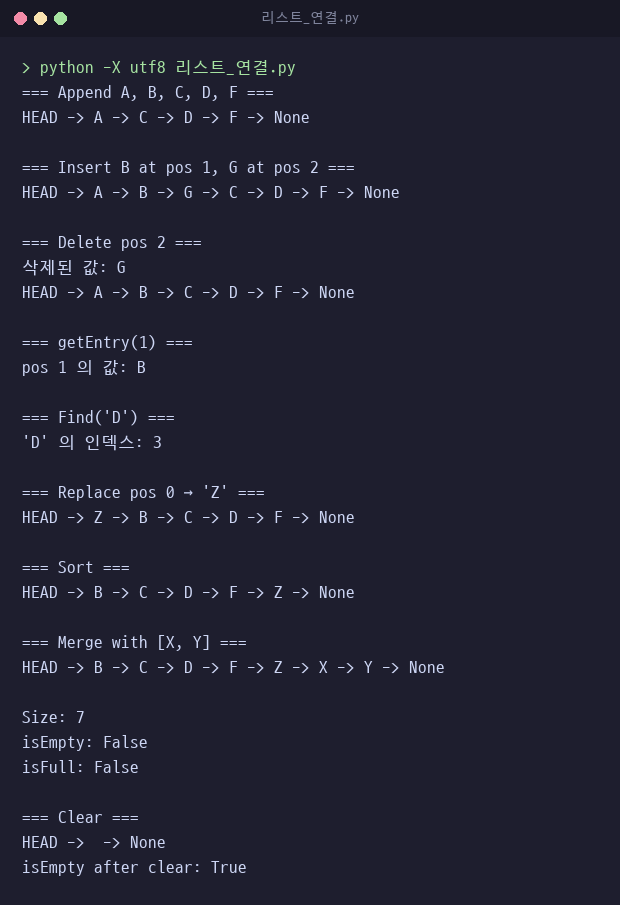

### 연결 리스트 클래스

[`연결리스트_클래스.py`](연결리스트_클래스.py) · 클래스 `Node`, `LinkedList`

`data`와 `link`로 이루어진 노드 기반 단순 연결 리스트. pos번째 노드를 찾는 `_get_node` 하나를 삽입·삭제·조회·교체가 함께 쓰고, 개수는 `size()`를 부를 때마다 순회로 계산.

| 메서드 | 동작 |
|---|---|
| `_get_node(pos)` | head에서 pos번 이동한 노드 반환, 중간에 끊기면 None |
| `insert(pos, e)` | `Node(e, prev.link)`로 새 노드를 만들어 앞 노드 뒤에 연결 |
| `delete(pos)` | 앞 노드의 `link`가 삭제 노드를 건너뛰게 바꾸고 삭제한 값 반환 |
| `get_entry(pos)` | 노드가 있으면 값, 없으면 None 반환 |
| `replace(pos, item)` | 노드가 있을 때만 값 교체 |
| `find(item)` | 처음 일치하는 위치 반환, 없으면 -1 |
| `size()` | head부터 끝까지 노드를 세어 반환 |
| `append(e)` | 마지막 노드까지 이동 후 연결 |
| `merge(lst)` | 다른 리스트의 값을 차례로 append |
| `sort()` | 교환이 없을 때까지 반복하는 버블 정렬 |
| `is_empty()` | head가 None인지 검사 |
| `is_full()` | 항상 False |
| `clear()` | head를 None으로 초기화 |
| `display()` | `head → A → None` 형식 출력 |

핵심 코드

```python
def _get_node(self, pos):
    n = self.head
    for _ in range(pos):
        if n is None:
            return None
        n = n.link
    return n

def get_entry(self, pos):
    n = self._get_node(pos)
    return n.data if n else None
```

구현 포인트
- 삽입·삭제는 pos - 1번째, 조회·교체는 pos번째 노드를 같은 `_get_node`로 구함
- 범위 밖 위치는 예외 없이 무시하거나 None 반환
- 개수 변수가 없어 삽입·삭제 코드가 짧은 대신 `size()`는 호출마다 전체 순회
- 정렬은 한 바퀴 동안 교환이 없으면 끝나므로 이미 정렬된 리스트는 한 번만 확인

두 연결 리스트 구현 차이

| 구분 | `리스트_연결.py` | `연결리스트_클래스.py` |
|---|---|---|
| 다음 노드 참조 | `next` | `link`, 생성자 인자로 지정 가능 |
| 개수 | `size` 변수 증감 | `size()` 호출 시 순회 |
| 위치 탐색 | 메서드마다 반복문 작성 | `_get_node` 공용 |
| 잘못된 위치 | 이동 중 노드가 끊기면 `IndexError` | 삽입·교체는 무시, 삭제·조회는 None 반환 |
| 정렬 | `size - 1`회 고정 반복, 내림차순 지원 | 교환이 없으면 종료 |
| 테스트 코드 | `if __name__ == "__main__":` 안 | 파일 끝에서 바로 실행 |

실행 결과

```text
head → A → B → C → D → None
head → Z → A → B → C → D → None
head → Z → A → X → B → C → D → None
Z
X
3
5
head → K → X → B → C → D → None
head → K → X → B → C → D → E → F → None
head → B → C → D → E → F → K → X → None
```

### 배열 스택

[`스택_배열.py`](스택_배열.py) · 클래스 `Stack`

크기 10 고정 배열의 뒤쪽 끝을 top으로 쓰는 스택. top 변수 없이 `size - 1` 칸이 top 위치.

| 메서드 | 동작 |
|---|---|
| `push(e)` | `stack[size]`에 저장 후 `size` 증가 |
| `pop()` | top 칸 값을 꺼내 None으로 비우고 반환 |
| `peek()` | top 값을 삭제 없이 반환 |
| `isfull()` | `size`가 10인지 검사 |
| `isempty()` | `size`가 0인지 검사 |
| `check_size()` | 원소 개수 반환 |

핵심 코드

```python
def push(self, e):
    if self.size == self.MAX_SIZE:
        self._print_error("full")
        return
    self.stack[self.size] = e
    self.size += 1

def pop(self):
    if self.size == 0:
        self._print_error("empty")
        return
    result = self.stack[self.size -1]
    self.stack[self.size -1] = None
    self.size -=1
    return result
```

구현 포인트
- 삽입과 삭제가 배열 끝에서만 일어나 원소 이동 없음
- 가득 찬 상태의 push, 빈 상태의 pop과 peek은 오류 문구 출력 후 None 반환
- 꺼낸 칸을 None으로 비워 배열에 꺼낸 값이 남지 않음

실행 결과

테스트 코드가 없어 단독 실행 시 출력 없음. 아래는 클래스를 불러와 호출한 결과.

| 호출 | 결과 |
|---|---|
| 1부터 11까지 차례로 push | 11번째에서 "스택이 가득 찼습니다." 출력, 10개만 저장 |
| `peek()` | 10 |
| pop 3회 | 10, 9, 8 순서로 반환 |
| 빈 스택에서 `pop()` | "스택의 item이 비어있습니다." 출력 후 None |

### 연결 스택

[`연결스택_클래스.py`](연결스택_클래스.py) · 클래스 `Node`, `Stack`

새 노드를 기존 top 앞에 연결하고 top을 새 노드로 옮기는 스택. 메서드 이름과 오류 문구가 배열 스택과 같아 두 구현을 바꿔 써도 호출 코드는 그대로.

| 메서드 | 동작 |
|---|---|
| `push(e)` | `Node(e, self.top)`으로 만든 새 노드를 top으로 지정 |
| `pop()` | top 값을 꺼내고 top을 다음 노드로 이동 |
| `peek()` | top 노드 값 반환 |
| `isfull()` | 항상 False |
| `isempty()` | `size`가 0인지 검사 |
| `check_size()` | 원소 개수 반환 |

핵심 코드

```python
def push(self, e):
    # 새 노드를 만들어 현재 top 위에 연결하고, top을 새 노드로 변경
    new_node = Node(e, self.top)
    self.top = new_node
    self.size += 1

def pop(self):
    if self.size == 0:
        self._print_error("empty")
        return
    # top 노드의 데이터를 꺼내고, top을 그 다음 노드로 이동
    result = self.top.data
    self.top = self.top.link
    self.size -= 1
    return result
```

구현 포인트
- push와 pop 모두 top 참조 하나만 바꿔 원소 수와 관계없이 작업량 일정
- 용량 제한이 없어 가득 참 검사는 항상 False
- 원소 개수를 `size` 변수로 따로 관리해 `isempty`와 `check_size`가 노드 순회 없이 동작

실행 결과

단독 실행 시 출력 없음. 테스트 코드 대신 클래스를 불러와 확인한 결과.

| 호출 | 결과 |
|---|---|
| 1부터 11까지 차례로 push | 11개 모두 저장, `isfull()` 결과 False |
| `peek()` | 11 |
| pop 3회 | 11, 10, 9 순서로 반환 |
| 빈 스택에서 `pop()` | "스택의 item이 비어있습니다." 출력 후 None |

### 선형 큐

[`선형큐_클래스.py`](선형큐_클래스.py) · 클래스 `LinearQueue`

front와 rear가 -1에서 시작해 증가만 하는 배열 큐. 기본 용량 10.

| 메서드 | 동작 |
|---|---|
| `enqueue(e)` | rear를 한 칸 늘리고 저장, 가득 차면 False |
| `dequeue()` | front를 한 칸 늘리고 그 칸 값을 꺼내 None으로 비움 |
| `peek()` | `queue[front + 1]` 반환 |
| `size()` | `rear - front` 반환 |
| `is_full()` | rear가 배열 마지막 칸인지 검사 |
| `is_empty()` | front와 rear가 같은지 검사 |
| `clear()` | 배열을 비우고 front와 rear를 -1로 초기화 |
| `print_queue()` | front 다음 칸부터 rear까지 출력 |

핵심 코드

```python
def is_full(self):
    return self.rear == self.capacity - 1

def is_empty(self):
    return self.front == self.rear

def dequeue(self):
    if self.is_empty():
        print("underflow — 큐가 비어있습니다")
        return None
    self.front += 1
    item = self.queue[self.front]
    self.queue[self.front] = None
    return item
```

구현 포인트
- front는 맨 앞 원소의 바로 앞 칸, rear는 맨 뒤 원소 칸. 둘이 같으면 공백
- 가득 참을 rear 위치로만 판정하므로 꺼내서 생긴 앞쪽 빈칸은 재사용 불가
- 이 한계를 원형 큐가 나머지 연산으로 해결

실행 결과

기본 용량 10이라 테스트의 5개 삽입은 모두 성공.

```text
[A, B, C, D]
[A, B, C, D, E]
A
[B, C, D, E]
B
4
```

호출로 확인한 동작

| 호출 | 결과 |
|---|---|
| `LinearQueue(3)`에 1, 2, 3 enqueue 후 dequeue 1회 | 1 반환, 남은 원소 `[2, 3]` |
| 이어서 4 enqueue | 앞쪽 빈칸이 있어도 "overflow — 큐가 가득 찼습니다" 출력 후 False |

### 원형 큐

[`원형큐_클래스.py`](원형큐_클래스.py) · 클래스 `ArrayQueue`, `LinkedQueue`

front와 rear를 나머지 연산으로 증가시켜 배열 끝 다음 칸을 0번 칸으로 잇는 원형 배열 큐. 같은 파일의 `LinkedQueue`는 [연결 큐](#연결-큐)와 같은 코드.

| 메서드 | 동작 |
|---|---|
| `enqueue(e)` | `(rear + 1) % capacity` 칸에 저장, 가득 차면 overflow 출력 후 False |
| `dequeue()` | `(front + 1) % capacity` 칸 값을 꺼내 None으로 비움 |
| `peek()` | `(front + 1) % capacity` 칸 값 반환 |
| `size()` | `(rear - front + capacity) % capacity` 반환 |
| `is_full()` | rear 다음 칸이 front인지 검사 |
| `is_empty()` | front와 rear가 같은지 검사 |
| `clear()` | 새 배열로 바꾸고 front와 rear를 0으로 초기화 |

핵심 코드

```python
def is_full(self):
    return (self.rear + 1) % self.capacity == self.front

def is_empty(self):
    return self.front == self.rear

def enqueue(self, e):
    if self.is_full():
        print("overflow")
        return False
    self.rear = (self.rear + 1) % self.capacity
    self.queue[self.rear] = e
    return True
```

구현 포인트
- 배열 끝에 닿은 rear가 다음 삽입 때 0번 칸으로 돌아가 선형 큐에서 버려지던 앞쪽 빈칸 재사용
- 공백은 front와 rear가 같을 때, 포화는 rear 다음 칸이 front일 때. 두 상태를 구분하려고 한 칸을 항상 비워 용량보다 하나 적게 저장
- 개수 계산에 capacity를 더해 rear가 front보다 앞 인덱스에 있어도 음수가 나오지 않음
- 테스트 코드를 `if __name__ == "__main__":` 안에 두어 원형 덱이 import할 때 큐 테스트 미실행

실행 결과

```text
=== ArrayQueue ===
A
3
A
B
1
```

호출로 확인한 동작

| 호출 | 결과 |
|---|---|
| `ArrayQueue(5)`에 A부터 F까지 enqueue | A부터 D까지 4개 저장, E와 F는 overflow 출력 후 False |
| dequeue 2회 | A, B 반환 |
| E, F 다시 enqueue | rear가 배열 끝을 지나 인덱스 0, 1에 저장. 배열 `['E', 'F', None, 'C', 'D']` |
| `size()` | 4 |

### 연결 큐

[`연결큐_클래스.py`](연결큐_클래스.py) · 클래스 `Node`, `LinkedQueue`

front와 rear 두 노드 참조로 양 끝을 가리키는 연결 큐. [`원형큐_클래스.py`](원형큐_클래스.py) 안의 `LinkedQueue`와 같은 코드.

| 메서드 | 동작 |
|---|---|
| `enqueue(e)` | 비어 있으면 front와 rear 모두 새 노드로, 아니면 rear 뒤에 연결 후 rear 이동 |
| `dequeue()` | front 값을 꺼내고 front를 다음 노드로 이동 |
| `peek()` | front 노드 값 반환 |
| `size()` | `_size` 반환 |
| `is_empty()` | front가 None인지 검사 |
| `clear()` | front와 rear를 None, `_size`를 0으로 초기화 |

핵심 코드

```python
def is_empty(self):
    return self.front is None

def dequeue(self):
    if self.is_empty():
        print("underflow")
        return None
    item = self.front.data
    self.front = self.front.next
    if self.front is None:
        self.rear = None
    self._size -= 1
    return item
```

구현 포인트
- rear 참조로 맨 뒤 노드에 바로 연결해 삽입 시 순회 불필요
- 마지막 노드를 꺼내 front가 None이 되면 rear도 None으로 맞춰 빠져나간 노드를 가리키지 않게 처리
- 용량 제한이 없어 `is_full` 메서드 없음. 개수는 `_size` 변수로 관리

실행 결과

```text
=== LinkedQueue ===
A
3
A
B
1
```

### 선형 덱

[`선형덱_클래스.py`](선형덱_클래스.py) · 클래스 `LinearDeque`

선형 큐 구조에 앞쪽 추가와 뒤쪽 삭제를 더한 배열 덱. front와 rear가 -1에서 시작하고 기본 용량 10.

| 메서드 | 동작 |
|---|---|
| `add_rear(e)` | rear를 한 칸 늘리고 저장 |
| `add_front(e)` | front 칸에 저장 후 front를 한 칸 줄임. front가 -1이면 거부 |
| `delete_front()` | front를 한 칸 늘리고 그 칸 값을 꺼냄 |
| `delete_rear()` | rear 칸 값을 꺼내고 rear를 한 칸 줄임 |
| `get_front()` | `queue[front + 1]` 반환 |
| `get_rear()` | `queue[rear]` 반환 |
| `size()` | `rear - front` 반환 |
| `is_full()` | rear가 배열 마지막 칸인지 검사 |
| `is_empty()` | front와 rear가 같은지 검사 |
| `clear()` | 배열을 비우고 front와 rear를 -1로 초기화 |
| `print_deque()` | front 다음 칸부터 rear까지 출력 |

핵심 코드

```python
def is_full(self):
    # rear가 배열 끝에 닿으면 가득 찬 것으로 판단
    return self.rear == self.capacity - 1

def add_front(self, e):
    # 앞(front)에 요소를 추가합니다
    # front가 -1이면 앞쪽 빈칸 없음, 음수 인덱스 기록 방지
    if self.front < 0:
        print("overflow — 앞쪽 공간이 없습니다")
        return False
    self.queue[self.front] = e
    self.front -= 1
    return True
```

구현 포인트
- front가 맨 앞 원소의 바로 앞 칸을 가리키므로 앞쪽 추가는 front 칸에 저장한 뒤 front 감소
- 앞쪽 빈칸은 `delete_front`로 front가 0 이상이 된 뒤에만 존재. front가 -1이면 추가를 거부해 `queue[-1]`, 곧 배열 마지막 칸에 기록되는 것 방지
- 가득 참은 rear 위치로만 판정해 선형 큐와 같은 한계 유지

실행 결과

빈 덱의 `add_front('X')`는 거부되고, A를 꺼낸 뒤의 `add_front('A')`는 비워진 0번 칸에 저장.

```text
overflow — 앞쪽 공간이 없습니다
A
[A, B, C]
A
C
3
A
C
[B]
```

### 원형 덱

[`원형덱_클래스.py`](원형덱_클래스.py) · 클래스 `Deque`, 부모 클래스 `ArrayQueue`

[원형 큐](#원형-큐)의 `ArrayQueue`를 상속하고 덱에만 있는 연산을 더한 원형 배열 덱.

| 메서드 | 동작 |
|---|---|
| `add_rear(e)` | rear를 다음 칸으로 옮겨 저장. 부모 `enqueue`와 같은 동작 |
| `delete_front()` | front를 다음 칸으로 옮겨 그 칸 값을 꺼냄. 부모 `dequeue`와 같은 동작 |
| `add_front(e)` | front 칸에 저장 후 front를 이전 칸으로 이동 |
| `delete_rear()` | rear 칸 값을 꺼내고 rear를 이전 칸으로 이동 |
| `get_front()` | `(front + 1) % capacity` 칸 값 반환 |
| `get_rear()` | rear 칸 값 반환 |
| `is_full()` | 부모 메서드. rear 다음 칸이 front인지 검사 |
| `is_empty()` | 부모 메서드. front와 rear가 같은지 검사 |
| `size()` | 부모 메서드. `(rear - front + capacity) % capacity` 반환 |
| `clear()` | 부모 메서드. 배열과 front, rear 초기화 |

핵심 코드

```python
from 원형큐_클래스 import ArrayQueue  # 원형큐_클래스.py 에서 원형 큐 클래스를 가져옵니다

class Deque(ArrayQueue):
    # ArrayQueue 를 상속받으므로 is_full, is_empty, size, clear 는
    # 부모 클래스 것을 그대로 사용합니다.

    def add_front(self, e):
        # 덱의 맨 앞(front)에 요소를 추가합니다 (일반 큐에는 없는 덱만의 기능)
        if self.is_full():
            print("overflow - 덱이 가득 찼습니다")
            return False
        self.queue[self.front] = e
        self.front = (self.front - 1 + self.capacity) % self.capacity
        return True
```

구현 포인트
- 상태 변수와 공백·포화 판정을 부모에서 그대로 받아 덱 고유 연산만 새로 작성
- 이전 칸 이동은 `(x - 1 + capacity) % capacity`. capacity를 더해 0번 칸에서 뒤로 갈 때 -1 대신 마지막 인덱스로 이동
- 테스트의 `add_front('A')`는 front가 0일 때 실행되어 A를 0번 칸에 저장하고 front를 9로 옮김
- `원형큐_클래스.py`의 테스트 코드가 `if __name__ == "__main__":` 안에 있어 import해도 덱 테스트 출력만 표시

실행 결과

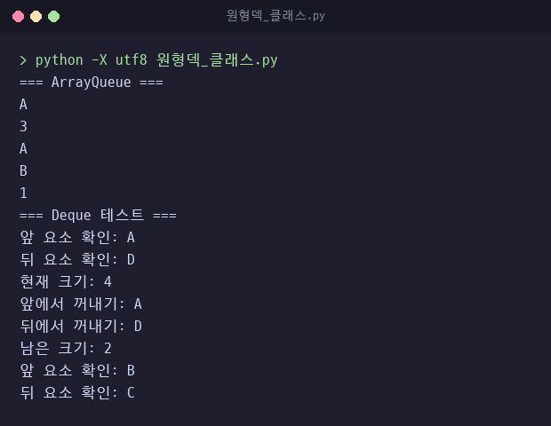

### 우선순위 큐

[`우선순위큐_클래스.py`](우선순위큐_클래스.py) · 클래스 `PriorityQueue`

`(우선순위, 데이터)` 튜플을 우선순위 순서로 정렬해 두는 배열 우선순위 큐. 숫자가 작을수록 먼저 나오고 기본 용량 10.

| 메서드 | 동작 |
|---|---|
| `enqueue(e, priority)` | 뒤에서부터 우선순위 숫자가 더 큰 원소를 한 칸씩 밀고 빈자리에 삽입 |
| `dequeue()` | 맨 앞 튜플을 꺼내고 나머지를 한 칸씩 당긴 뒤 데이터만 반환 |
| `peek()` | 맨 앞 데이터 반환 |
| `is_full()` | `size`가 용량과 같은지 검사 |
| `is_empty()` | `size`가 0인지 검사 |
| `clear()` | 배열을 비우고 `size`를 0으로 초기화 |
| `print_queue()` | `데이터(p우선순위)` 형식으로 출력 |

`size`는 메서드가 아닌 속성.

핵심 코드

```python
def enqueue(self, e, priority):
    if self.is_full():
        print("overflow")
        return False

    # 우선순위 높은 순(숫자 작을수록 높음)으로 정렬해서 삽입
    i = self.size - 1
    while i >= 0 and self.queue[i][0] > priority:
        self.queue[i + 1] = self.queue[i]  # 한 칸씩 뒤로 밀기
        i -= 1
    self.queue[i + 1] = (priority, e)
    self.size += 1
    return True
```

구현 포인트
- 삽입 때 정렬 상태를 유지해 꺼낼 때는 맨 앞만 확인
- 비교 조건이 `>`라 우선순위가 같은 원소는 밀지 않음. 먼저 들어온 원소가 앞에 남아 같은 우선순위끼리 삽입 순서 유지
- 꺼낸 뒤 나머지를 앞으로 당겨 가장 높은 우선순위가 항상 0번 칸
- `size`가 속성이라 테스트 마지막 줄은 `print(pq.size)`로 남은 개수 출력

실행 결과

`환자C 3`, `환자A 1`, `환자D 3`, `환자B 2` 순서로 삽입. 우선순위가 같은 환자C와 환자D는 삽입 순서대로 출력.

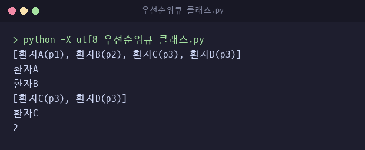

### 배열 집합

[`집합_배열.py`](집합_배열.py) · 클래스 `Set`

크기 10 고정 배열에 중복 없이 원소를 저장하는 집합. 집합 연산은 결과용 `Set`을 새로 만들어 반환.

| 메서드 | 동작 |
|---|---|
| `insert(e)` | 기존 원소와 모두 비교해 중복이면 거부 |
| `delete(e)` | 찾은 위치 뒤 원소를 한 칸씩 당기고 삭제한 값 반환 |
| `union(setB)` | 결과 배열을 두 집합 최대 크기의 합으로 늘린 뒤 두 집합 원소를 차례로 삽입 |
| `intersect(setB)` | 양쪽에 모두 있는 원소만 삽입. 결과 크기는 작은 집합의 원소 개수 |
| `difference(setB)` | setB에 없는 원소만 삽입. 결과 크기는 자기 원소 개수 |
| `equals(setB)` | 개수가 같고 차집합이 비었는지로 판정 |
| `isfull()` | 원소 개수가 10인지 검사 |
| `isempty()` | 원소 개수가 0인지 검사 |
| `check_size()` | 원소 개수 반환 |
| `display()` | `data[:size]` 출력 |

핵심 코드

```python
def union(self, setB):
    result = Set()
    result.MAX_SIZE = self.MAX_SIZE + setB.MAX_SIZE  # 20으로 확장
    result.data = [None] * result.MAX_SIZE
    for i in self.data[:self.size]:
        result.insert(i)
    for j in setB.data[:setB.size]:
        result.insert(j)
    return result
```

구현 포인트
- 중복 검사를 `insert` 한 곳에 두고 합집합도 `insert`로 채워 중복 처리 재사용. 테스트 출력의 중복 문구 2줄은 합집합 과정에서 거부된 2와 3
- 삭제 시 뒤 원소를 당겨 원소가 항상 `data[:size]` 안에 연속으로 모임
- equals는 개수가 같다는 조건 아래 A - B가 비면 두 집합이 같다는 점을 이용해 차집합 한 번으로 판정

실행 결과

a는 {1, 2, 3}에서 1을 삭제해 {2, 3}, b는 {2, 3, 4}. a가 b에 포함되어 차집합은 빈 집합.

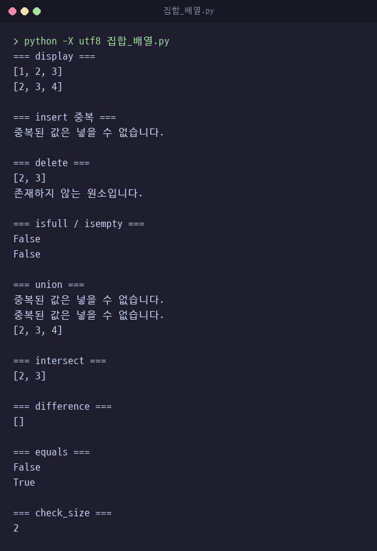

### 연결 집합

[`집합_연결.py`](집합_연결.py) · 클래스 `Node`, `LinkedSet`

새 원소를 head 앞에 붙이는 연결 집합. 파일 끝 문자열에 목표 연산 목록이 있으며 구현 상태는 아래 표와 같음.

| 메서드 | 동작 |
|---|---|
| `contain(e)` | head부터 순회하며 e가 있는지 검사 |
| `insert(e)` | `contain`으로 중복 검사 후 새 노드를 head 앞에 연결 |
| `delete(e)` | prev와 current로 이동하다 일치 노드를 링크에서 제외. 반환값 없음 |
| `isempty()` | `size`가 0인지 검사 |
| `union(setB)` | 빈 `LinkedSet`만 반환하는 미구현 상태 |
| `isfull()` | 주석 처리된 선언만 있음 |
| `intersect(setB)` | 미구현 |
| `difference(setB)` | 미구현 |
| `equals(setB)` | 미구현 |
| `size()` | 미구현. 개수는 `size` 속성에 기록 |
| `display()` | 미구현 |

핵심 코드

```python
def insert(self, e):
    if self.contain(e):
        print("이미 존재하는 item입니다.")
        return
    new_node = Node(e)
    new_node.next = self.head
    self.head = new_node
    self.size += 1
```

구현 포인트
- 머리 삽입이라 연결 자체는 끝까지 이동할 필요가 없고, 중복 검사인 `contain`만 전체 순회
- 삭제는 prev와 current 두 참조를 함께 옮기다 일치하면 prev의 링크가 current 다음 노드를 가리키게 변경. 첫 노드면 head 교체

실행 결과

테스트 코드가 없어 단독 실행 시 출력 없음. 클래스를 불러와 호출한 결과는 다음과 같음.

| 호출 | 결과 |
|---|---|
| 1, 2, 3 차례로 insert | head부터 3, 2, 1 순서로 연결 |
| `insert(2)` | "이미 존재하는 item입니다." 출력 |
| `delete(2)` | 2 제거, 반환값 None |
| `delete(99)` | "존재하지 않는 item입니다." 출력 |
| 원소 9가 든 집합 b로 `union(b)` | 원소 없는 빈 집합 반환 |

### 결함 수정 이력

실행 중 발견해 수정한 결함.

| 파일 | 결함 | 수정 | 커밋 |
|---|---|---|---|
| [`리스트_연결.py`](리스트_연결.py) | is_empty·is_full·size_of의 `return` 누락으로 항상 None 반환 | 반환값 추가 | `0f7ef6d` |
| [`선형덱_클래스.py`](선형덱_클래스.py) | front가 -1일 때 앞쪽 추가 시 `queue[-1]`, 즉 배열 마지막 칸에 기록 | front가 -1이면 추가 거부 | `0f7ef6d` |
| [`집합_배열.py`](집합_배열.py) | 삭제 자리에 None이 남고 마지막 원소가 유효 범위 밖으로 빠짐 | 뒤 원소를 한 칸씩 당겨 빈칸 제거 | `0f7ef6d` |
| [`원형큐_클래스.py`](원형큐_클래스.py) | 테스트 코드가 `if __name__ == "__main__":` 밖에 있어 `원형덱_클래스.py`가 import할 때 큐 테스트 출력 | 테스트 코드를 `if __name__ == "__main__":` 안으로 이동 | `c8ddd91` |

---

## 2. 자료구조 응용

앞 절에서 구현한 자료구조 개념을 실제 문제에 적용한 콘솔 프로그램.
1절 클래스를 import하지 않고 파이썬 리스트를 스택과 큐로 사용.

### 괄호 검사

[`괄호검사.py`](괄호검사.py) · 함수 `check_brackets`

문자열을 한 글자씩 읽으며 여는 괄호는 쌓아 두고, 닫는 괄호가 나오면 가장 최근에 연 괄호와 짝을 비교하는 함수.
괄호가 아닌 글자는 건너뜀.

| 자료구조 | 변수 | 용도 |
|---|---|---|
| 리스트를 스택으로 사용 | `stack` | 아직 닫히지 않은 여는 괄호. `append`로 넣고 `pop`으로 꺼냄 |
| 딕셔너리 | `match` | 닫는 괄호마다 짝이 되는 여는 괄호 |

핵심 코드

```python
def check_brackets(s):
    stack = []
    match = {')': '(', ']': '[', '}': '{'}

    for ch in s:
        if ch in '([{':
            stack.append(ch)
        elif ch in ')]}':
            if not stack or stack[-1] != match[ch]:
                return "ERROR"  # 스택이 비었거나 짝이 다름
            stack.pop()

    return "OK" if not stack else "ERROR"  # 스택이 비어야 정상
```

구현 포인트
- 짝 정보를 딕셔너리 하나에 모아 괄호 종류와 관계없이 같은 조건문으로 비교
- 닫는 괄호에서 `not stack`을 먼저 검사해 빈 스택의 `stack[-1]` 접근 방지. `)(`처럼 닫는 괄호가 먼저 나오면 바로 ERROR
- 끝까지 읽은 뒤 스택에 괄호가 남아 있으면 ERROR. `((`처럼 닫히지 않은 괄호 검출
- 테스트 코드가 없는 함수 파일이라 단독 실행 시 출력 없음

실행 결과

`MakeListSet` 폴더에서 `python -X utf8 -c`로 함수를 불러와 호출한 결과.

| 입력 | 결과 | 판정 근거 |
|---|---|---|
| `{ A[ (i+1) ]=0; }` | OK | 모든 닫는 괄호가 스택 맨 위 여는 괄호와 짝 |
| `A( (i+1] )=0;` | ERROR | `]`가 나온 시점의 스택 맨 위가 `(` |
| `((` | ERROR | 끝까지 읽은 뒤 스택에 `(` 두 개 남음 |
| `)(` | ERROR | 첫 글자 `)`에서 스택이 비어 있음 |

### 수식 계산기

[`수식계산기.py`](수식계산기.py) · 클래스 `Calculate`

중위 표기식을 후위 표기식으로 바꾼 뒤 계산하는 계산기.
괄호 검사부터 계산까지 모든 단계에서 리스트를 스택으로 사용.

| 메서드 | 동작 | 사용 자료구조 |
|---|---|---|
| `check_brackets(expr)` | 괄호 짝 검사. 괄호 검사 항목과 같은 방식 | 리스트 스택에 여는 괄호 |
| `tokenize(expr)` | 이어진 숫자와 소수점은 한 토큰, 연산자와 괄호는 글자 하나가 한 토큰. 공백은 버림 | 리스트 `tokens` |
| `infix_to_postfix(expr)` | 토큰을 후위 표기식 문자열로 변환. 우선순위는 `* /` 2, `+ -` 1 | 리스트 스택에 연산자와 여는 괄호, 딕셔너리 `prec`에 우선순위 |
| `evaluate_postfix(expr)` | 숫자는 스택에 넣고, 연산자가 나오면 두 개를 꺼내 계산한 값을 다시 넣음 | 리스트 스택에 피연산자와 중간 결과 |
| `evaluate_infix(expr)` | 괄호 검사 후 변환과 계산 연결. 괄호가 맞지 않으면 `ValueError("괄호 오류")` | 앞 메서드 호출 |

핵심 코드

```python
for token in self.tokenize(expr):
    if token == '(':
        stack.append(token)
    elif token == ')':
        while stack and stack[-1] != '(':
            result.append(stack.pop())
        stack.pop()  # '(' 제거
    elif token in prec:
        while stack and stack[-1] != '(' and prec.get(stack[-1], 0) >= prec[token]:
            result.append(stack.pop())
        stack.append(token)
    else:
        result.append(token)  # 숫자
```

구현 포인트
- 스택 맨 위 연산자의 우선순위가 같거나 높으면 먼저 꺼내 출력. 같은 우선순위는 왼쪽부터 계산되어 `8 / 2 - 3 + 3 * 2`가 `8 2 / 3 - 3 2 * +`로 변환
- 닫는 괄호가 나오면 여는 괄호까지 스택을 비우고, 식이 끝나면 남은 연산자를 모두 꺼내 결과 뒤에 붙임
- 식 맨 앞, 또는 연산자나 여는 괄호 바로 뒤의 `-`는 빼기가 아닌 음수 부호로 보고 뒤 숫자에 붙임
- 나눗셈 몫이 정수면 `int`, 아니면 실수 유지. `8 / 2`는 4, `7 / 2`는 3.5
- 연산자 앞 숫자가 두 개 미만이거나 계산 후 스택에 숫자가 하나가 아니면 `ValueError("잘못된 수식입니다")`. 숫자로 바꿀 수 없는 토큰도 같은 오류

실행 결과

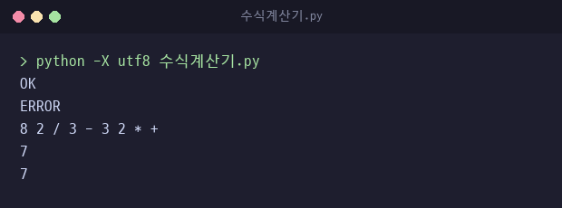

테스트 코드 외에 메서드를 호출해 확인한 결과.

| 입력 | 후위 표기식 | 결과 |
|---|---|---|
| `-3+5` | `-3 5 +` | 2 |
| `2*-3` | `2 -3 *` | -6 |
| `(12+3)/2` | `12 3 + 2 /` | 7.5 |

한계
- `[ ]`, `{ }` 괄호는 짝 검사만 하고 계산에는 미지원. `[1+2]*3`은 잘못된 수식 처리
- 괄호 앞 음수 부호 미지원. `-(2+3)`은 잘못된 수식 처리
- 0으로 나누면 `ZeroDivisionError` 발생

수정 이력

커밋 `c8ddd91`에서 수정한 결함.
- 공백으로만 토큰을 구분해 `(1+2)*3`처럼 붙여 쓴 식을 한 토큰으로 처리. `tokenize`를 추가해 글자 단위로 분리
- 나눗셈을 `int(a / b)`로 계산해 소수점 이하 버림. 몫이 정수일 때만 `int`로 바꾸도록 수정
- 잘못된 식 미검출. 연산자 앞 숫자 개수와 계산 후 남은 숫자 개수 검사 추가
- `evaluate_infix`에서 괄호 검사 없이 계산. 계산 전 `check_brackets` 호출 추가

### 미로 탐색 비교

세 프로그램은 같은 6×6 미로에서 다음에 방문할 칸을 고르는 자료구조만 다름.
좌표는 `(행, 열)`, 시작 `(1, 0)`, 출구 `(3, 5)`. 벽은 `■`, 길은 `□`.

```text
■ ■ ■ ■ ■ ■
S □ □ □ □ ■
■ □ ■ □ ■ ■
■ ■ ■ □ □ E
■ ■ ■ ■ ■ ■
■ ■ ■ ■ ■ ■
```

`(1, 4)`와 `(2, 1)`은 더 갈 곳이 없는 막다른 칸.

| 구분 | 깊이 우선 | 너비 우선 | 우선순위 |
|---|---|---|---|
| 파일 | `미로탐색_깊이우선.py` | `미로탐색_너비우선.py` | `미로탐색_전략적.py` |
| 자료구조 | 리스트 스택 | 리스트 큐 | 정렬 리스트 우선순위 큐 |
| 꺼내는 칸 | 가장 나중에 넣은 칸 | 가장 먼저 넣은 칸 | 출구까지 거리 제곱이 가장 작은 칸 |
| 방문 처리 시점 | 꺼낼 때 | 넣을 때 | 꺼낼 때 |
| 방문 칸 수 | 9 | 10 | 8 |
| 방문한 막다른 칸 | `(1, 4)` | `(2, 1)`, `(1, 4)` | 없음 |
| 경로 | 8칸. 이전 칸 기록으로 복원 | 8칸 최단 경로. 부모 딕셔너리로 복원 | 복원 없음. 방문 순서만 출력 |
| 최단 경로 보장 | 없음 | 있음 | 없음 |

방문 칸 수와 경로는 세 프로그램의 실행 출력 기준.

### 깊이 우선 미로 탐색

[`미로탐색_깊이우선.py`](미로탐색_깊이우선.py) · 클래스 `MazeSolver`

리스트를 스택으로 사용해 가장 나중에 넣은 칸부터 꺼내는 깊이 우선 탐색.
한 갈래를 끝까지 들어간 뒤 막히면 스택에 남은 다른 갈래로 되돌아감.

| 자료구조 | 변수 | 용도 |
|---|---|---|
| 리스트를 스택으로 사용 | `self.stack` | 방문할 칸과 그 칸을 넣은 이전 칸의 쌍 |
| 2차원 리스트 | `self.visited` | 칸별 방문 여부 |
| 딕셔너리 | `self.parent` | 방문한 칸의 이전 칸 |
| 리스트 | `self.path` | 복원한 시작부터 출구까지의 경로 |

| 메서드 | 동작 |
|---|---|
| `solve(verbose=True)` | 스택 탐색 후 출구에서 경로 복원. `verbose`가 참이면 방문 칸마다 위치 출력 |
| `print_maze()` | 경로 칸을 `·`로 바꿔 미로 출력 |
| `reset()` | 탐색 상태 변수 초기화 |
| `_find_start_exit()` | 미로 문자 `e`와 `x`의 위치로 시작점과 출구 탐색 |

핵심 코드

```python
self.stack.append((start, None))

while self.stack:
    pos, prev = self.stack.pop()
    r, c = pos

    if self.visited[r][c]:
        continue
    self.visited[r][c] = True
    self.parent[pos] = prev
```

구현 포인트
- 이웃 칸을 위, 아래, 왼쪽, 오른쪽 순서로 넣고 마지막에 넣은 칸부터 꺼내므로 오른쪽 갈래를 먼저 탐색. `(1, 3)`에서 막다른 칸 `(1, 4)`에 먼저 들어간 뒤 스택에 남은 `(2, 3)`으로 되돌아감
- 방문 처리는 꺼내는 시점. 같은 칸이 서로 다른 이웃에서 두 번 들어올 수 있어 꺼낼 때 `visited`를 다시 검사
- 이웃을 넣을 때 `self.stack.append(((nr, nc), pos))`로 현재 칸을 함께 저장하고 방문 시 `parent`에 기록. 출구 도착 후 `parent`를 시작점까지 거슬러 올라간 뒤 `reverse()`로 경로 복원
- 방문은 9칸이지만 복원한 경로는 막다른 칸 `(1, 4)`를 뺀 8칸. `(2, 1)`은 스택에 남은 채 출구에 먼저 도착해 방문하지 않음

실행 결과

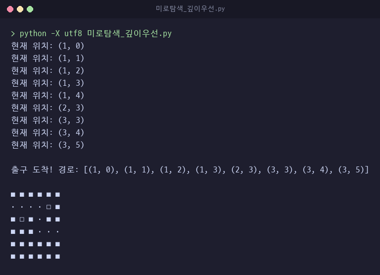

수정 이력

커밋 `0f7ef6d`에서 수정한 결함.
- 방문한 모든 칸을 경로로 출력해 막다른 칸까지 경로에 포함. 칸마다 이전 칸을 기록하고 출구에서 거슬러 올라가 경로만 복원

### 너비 우선 미로 탐색

[`미로탐색_너비우선.py`](미로탐색_너비우선.py) · 클래스 `BFSMazeSolver`

리스트를 큐로 사용해 먼저 넣은 칸부터 꺼내는 너비 우선 탐색.
시작점에서 가까운 칸부터 차례로 퍼져 나가므로 처음 출구에 닿은 경로가 최단 경로.

| 자료구조 | 변수 | 용도 |
|---|---|---|
| 리스트를 큐로 사용 | `solve`의 지역 변수 `queue` | 방문할 칸. 뒤에 `append`, 앞에서 `pop(0)` |
| 2차원 리스트 | `self.visited` | 큐에 넣은 칸 표시 |
| 딕셔너리 | `self.parent` | 칸마다 그 칸을 큐에 넣은 이전 칸 |

| 메서드 | 동작 |
|---|---|
| `solve()` | 큐 탐색. 출구 도착 시 경로 리스트, 실패 시 `None` 반환 |
| `get_path(start, exit_pos)` | 출구에서 `parent`를 따라 시작점까지 올라간 뒤 뒤집어 경로 반환 |
| `print_maze(path)` | 시작과 출구를 뺀 경로 칸을 `·`로 표시해 출력 |
| `find_start_and_exit()` | 시작점과 출구 위치 탐색 |

핵심 코드

```python
# 상하좌우 네 방향을 차례로 탐색
directions = [(-1, 0), (1, 0), (0, -1), (0, 1)]

for dr, dc in directions:
    nr = r + dr
    nc = c + dc

    # 미로 범위 안에 있는지 확인
    if 0 <= nr < self.size and 0 <= nc < self.size:
        # 아직 방문하지 않았고 이동 가능한 칸인지 확인
        if not self.visited[nr][nc] and self.maze[nr][nc] in ('0', 'x'):
            self.visited[nr][nc] = True
            self.parent[(nr, nc)] = (r, c)  # 이 칸의 부모(이전 칸)를 기록
            queue.append((nr, nc))
```

구현 포인트
- 큐에 넣는 시점에 방문 처리해 같은 칸이 큐에 두 번 들어가지 않음. 깊이 우선 탐색과 달리 꺼낼 때 재검사 불필요
- 부모도 넣는 시점에 한 번만 기록하므로 각 칸의 부모는 그 칸을 처음 발견한 칸. 이 기록을 따라 복원한 경로가 최단 경로
- 큐의 맨 앞 삭제는 `pop(0)`. 남은 원소를 한 칸씩 앞으로 당기는 리스트 연산
- 시작점과 가까운 칸부터 퍼지므로 막다른 칸 `(2, 1)`과 `(1, 4)` 모두 방문. 방문 10칸, 경로 8칸

실행 결과

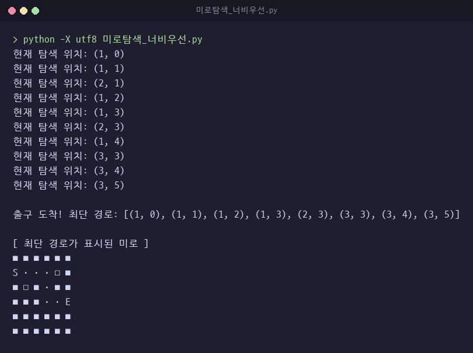

### 우선순위 미로 탐색

[`미로탐색_전략적.py`](미로탐색_전략적.py) · 클래스 `PriorityMazeSolver`

출구까지 거리가 가장 짧은 칸을 먼저 꺼내는 우선순위 탐색.
거리는 `(r - er)**2 + (c - ec)**2`로 계산한 직선 거리 제곱.

| 자료구조 | 변수 | 용도 |
|---|---|---|
| 리스트를 우선순위 큐로 사용 | `self.pq` | `(거리, 행, 열)` 튜플을 거리 오름차순으로 유지 |
| 2차원 리스트 | `self.visited` | 칸별 방문 여부 |

| 메서드 | 동작 |
|---|---|
| `_distance(r, c, exit)` | 출구까지 직선 거리 제곱 |
| `_enqueue(priority, r, c)` | 끝에 추가한 뒤 앞 원소보다 거리가 작은 동안 자리를 바꾸며 앞으로 이동 |
| `_dequeue()` | 맨 앞 원소를 꺼내고 나머지를 한 칸씩 앞으로 당김 |
| `solve(start, exit)` | 인자로 받은 시작점부터 거리가 짧은 칸 순서로 방문하며 출구 도착 여부 반환 |

핵심 코드

```python
def _distance(self, r, c, exit):
    er, ec = exit
    return (r - er)**2 + (c - ec)**2

def _enqueue(self, priority, r, c):
    item = (priority, r, c)
    i = len(self.pq) - 1
    self.pq.append(item)
    while i >= 0 and self.pq[i][0] > self.pq[i+1][0]:
        self.pq[i], self.pq[i+1] = self.pq[i+1], self.pq[i]
        i -= 1
```

구현 포인트
- `우선순위큐_클래스.py`와 같은 삽입 시 정렬 방식을 크기 제한 없는 리스트로 클래스 안에 다시 구현. 꺼낼 때는 항상 맨 앞 원소
- 비교가 `>`라 거리가 같으면 먼저 넣은 칸이 앞에 유지. `(1, 3)`에서 거리 5인 아래 칸 `(2, 3)`과 오른쪽 칸 `(1, 4)`를 이 순서로 넣어 `(2, 3)`을 먼저 꺼냄
- 그 결과 거리 29, 20, 13, 8, 5, 4, 1, 0 순서로 출구에 가까워지며 이 미로에서는 막다른 칸 방문 없음. 출구 도착 시점에 큐에는 `(1, 4)`와 `(2, 1)`이 남은 상태
- 거리 계산에 벽을 반영하지 않아 최단 경로를 보장하지 않음. 이전 칸 기록이 없어 경로 복원 없이 방문 순서만 출력

실행 결과

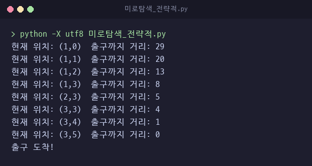

### 라인 편집기

[`라인편집기.py`](라인편집기.py) · 클래스 `FileIO`

줄 번호로 텍스트를 편집하는 라인 편집기.
리스트 `line_num`에 한 줄씩 원소로 담고, 줄 번호 n을 인덱스 n - 1로 바꿔 슬라이싱으로 삽입과 삭제 처리.

| 자료구조 | 변수 | 용도 |
|---|---|---|
| 리스트 | `self.line_num` | 편집 중인 줄 목록. 원소 하나가 줄 하나 |

| 메서드 | 동작 |
|---|---|
| `i(line_no, text)` | 해당 줄 앞 조각, 새 줄, 뒤 조각을 이어 붙인 새 리스트로 교체 |
| `d(line_no)` | 해당 줄을 뺀 앞뒤 조각을 이어 붙임 |
| `r(line_no, text)` | 해당 인덱스 값 교체 |
| `p()` | 줄 번호를 붙여 전체 출력 |
| `s()` | 목록 전체를 `text.txt`에 덮어써 저장 |
| `l()` | `text.txt`를 한 줄씩 읽어 목록 뒤에 추가 |
| `q()` | 종료 문구 출력 후 `exit()` |

핵심 코드

```python
def i (self, line_no, text):
    self.line_num = self.line_num[:line_no -1] + [text] + self.line_num[line_no -1:]

def d (self, line_no): self.line_num = self.line_num[:line_no -1] + self.line_num[line_no:]

def r (self, line_no, text): self.line_num[line_no -1] = text
```

구현 포인트
- `insert`와 `del` 대신 슬라이싱 결합으로 새 리스트 생성. 마지막 줄 다음 번호로 삽입하면 뒤 조각이 비어 끝에 추가
- 줄 끝 개행 문자를 내용에 포함해 보관. `s()`는 그대로 쓰고 `l()`은 개행까지 읽으므로 저장한 내용과 불러온 내용이 같음
- 같은 개행 때문에 `p()` 출력에서는 줄 사이에 빈 줄이 하나씩 추가로 표시됨
- 줄 번호 범위 검사는 없음. 검사는 Flet판에서 추가

테스트 코드 순서

| 순서 | 호출 | 내용 |
|---|---|---|
| 1 | `f.i(1, …)`, `f.i(2, …)`, `f.i(3, …)` | 세 줄 삽입 후 출력 |
| 2 | `f.i(2, "중간 삽입\n")` | 2번째 줄 자리에 삽입 |
| 3 | `f.r(1, "수정된 첫번째 줄\n")` | 1번째 줄 교체 |
| 4 | `f.s()` | `text.txt`에 저장 |
| 5 | `f2.l()`, `f2.p()` | 새 객체로 저장한 파일을 불러와 출력 |
| 6 | `f.d(2)` | 원래 객체에서 2번째 줄 삭제 |
| 7 | `f.q()` | 종료 |

실행하면 실행 위치에 `text.txt`를 만들거나 덮어씀.

---

## 3. Flet 시각화

콘솔 프로그램의 자료구조 처리 코드를 거의 그대로 옮기고 입력과 출력을 Flet 화면으로 바꾼 작성본.
콘솔 파일을 import하지 않고 같은 클래스를 파일 안에 다시 정의.
확인 환경은 Python 3.14, Flet 0.82.2. 화면 캡처는 Flet 웹 모드 실행 화면.
`ElevatedButton`은 Flet 0.80부터 사용 중단 예고 경고 출력.

### 수식 계산기 화면

[`수식계산기_flet.py`](수식계산기_flet.py) · 클래스 `calculate`, 함수 `main`

콘솔판과 같은 스택 기반 변환·계산 클래스에 입력창과 버튼 패드를 붙인 계산기.
식은 키보드로 입력하거나 버튼으로 입력.

| 구분 | 콘솔판 `수식계산기.py` | Flet판 `수식계산기_flet.py` |
|---|---|---|
| 입력 | 테스트 코드의 문자열 | 입력창 키보드 입력과 버튼 패드 |
| 괄호 검사 위치 | `evaluate_infix` 안에서 `ValueError` 발생 | `on_calculate`에서 계산 전에 검사해 괄호 오류 문구 표시 |
| 숫자 변환 | 정수는 `int`, 소수는 `float` | 모두 `float` |
| 결과 표시 | 나눗셈 몫이 정수면 `int` | 화면에 표시할 때 정수 값이면 `int`로 바꿔 표시 |
| 오류 처리 | `ValueError`, `ZeroDivisionError` 발생 | 모든 예외를 잡아 수식 오류 문구를 빨간색으로 표시. 0으로 나누기도 같은 문구 |

| 버튼 | 동작 |
|---|---|
| 숫자, 연산자, 괄호 | 입력창 끝에 공백 없이 이어 붙임 |
| `⌫` | 끝 공백을 지운 뒤 마지막 한 글자 삭제 |
| `C` | 입력창과 결과 비우기 |
| 계산 | 괄호 검사 후 계산. 입력창 옆과 버튼 패드 마지막 줄에 같은 버튼 객체 배치 |

핵심 코드

```python
def on_backspace(e):
    # 마지막 한 글자 제거
    text_field.value = (text_field.value or "").rstrip()[:-1]
    page.update()

def btn_click(val):
    def handler(e):
        # 공백 없이 이어 붙여 1, 2를 연속으로 누르면 12
        text_field.value = (text_field.value or "") + val
        page.update()
    return handler
```

구현 포인트
- `btn_click(val)`이 버튼마다 값을 기억하는 처리 함수를 만들어 반환. 버튼 생성은 `make_btn` 하나로 통일
- 입력값을 바꾼 뒤 `page.update()`를 호출해야 화면에 반영
- 연산자 버튼은 붉은 계열, 괄호 버튼은 파란 계열 색으로 숫자 버튼과 구분
- 빈 입력에서 계산 버튼을 누르면 아무 동작 없이 종료

실행 결과

버튼 입력 `(12+3)/2` 결과 7.5, 잘못된 식 `1 2 + 3` 오류 표시.

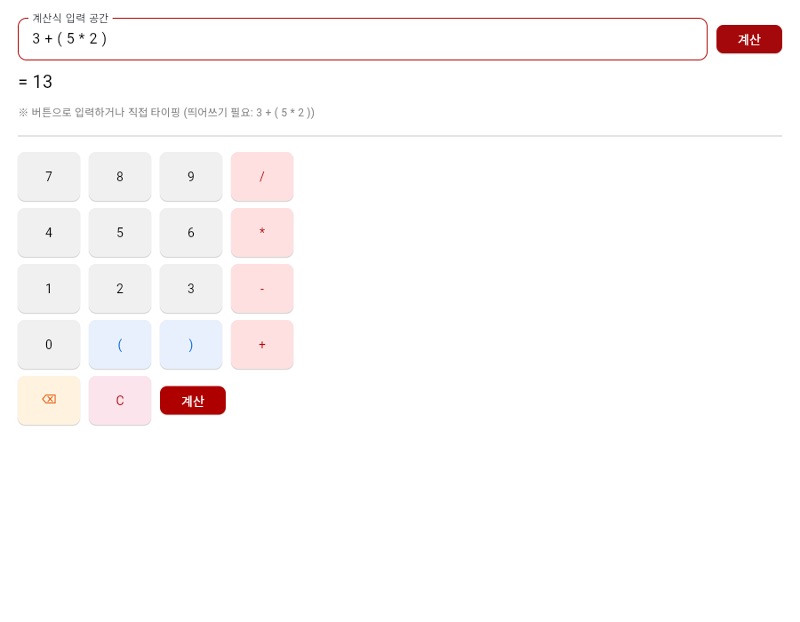 

수정 이력

커밋 `c8ddd91`에서 수정한 결함.
- 버튼 입력마다 값 뒤에 공백을 붙여 1, 2를 연속으로 눌러도 12가 아닌 두 숫자로 입력. 공백 없이 이어 붙이도록 변경
- `⌫` 버튼이 공백 기준으로 한 토큰씩 삭제. 마지막 한 글자 삭제로 변경
- 콘솔판과 같은 글자 단위 토큰 분리와 잘못된 식 검출 적용

### 미로 탐색 화면

[`미로탐색_깊이우선_flet.py`](미로탐색_깊이우선_flet.py) · [`미로탐색_너비우선_flet.py`](미로탐색_너비우선_flet.py) · [`미로탐색_전략적_flet.py`](미로탐색_전략적_flet.py)

콘솔 미로 탐색 세 작성본을 6×6 격자 화면으로 옮긴 판.
세 파일 모두 같은 미로와 같은 화면 구성이며, 탐색 코드는 각 콘솔판의 반복문 구조를 그대로 유지.
콘솔판에서 `print`하던 자리를 칸 색 변경과 화면 갱신으로 바꾼 것이 핵심 변경.

공통 구조

| 구성 | 구현 |
|---|---|
| 격자 | 칸마다 `ft.Container` 하나. 2차원 리스트 `self.cells`에 보관하고 `cells[r][c].bgcolor`를 바꿔 색 변경 |
| 탐색 함수 | `async def solve`. 한 칸을 꺼낼 때마다 `await asyncio.sleep`으로 대기해 한 칸씩 표시 |
| 중복 실행 방지 | 탐색 시작 시 `is_solving`을 참으로 바꾸고 탐색 버튼과 초기화 버튼을 `disabled = True`로 비활성화. 종료 시 다시 활성화 |
| 초기화 | 방문 배열과 탐색 자료구조를 비우고 칸 색을 처음 상태로 복원. 탐색 중에는 무시 |
| 상태 문구 | 격자 위 `status_text`에 진행 상황과 결과 표시 |
| 화면 테마 | `ThemeMode.DARK` |

색 의미

| 색 | 의미 |
|---|---|
| 초록 `GREEN_500`, 글자 S | 시작 |
| 빨강 `RED_500`, 글자 E | 출구 |
| 진한 회색 `GREY_800` | 벽 |
| 밝은 회색 `GREY_200` | 아직 방문하지 않은 길 |
| 노랑 `YELLOW_400` | 지금 꺼낸 칸 |
| 연한 파랑 `BLUE_200`, 점 | 깊이 우선과 너비 우선에서 방문한 칸 |
| 진한 파랑 `BLUE_400`, 점 | 깊이 우선과 너비 우선에서는 복원한 경로, 우선순위에서는 방문한 칸 |

파일별 차이

| 구분 | 깊이 우선 | 너비 우선 | 우선순위 |
|---|---|---|---|
| 클래스 | `VisualMazeSolver` | `BFSVisualMazeSolver` | `VisualPriorityMazeSolver` |
| 탐색 자료구조 | 리스트 스택 `self.stack` | `solve` 안의 지역 리스트 큐 `queue` | 정렬 리스트 우선순위 큐 `self.pq` |
| 한 칸 대기 시간 | 0.3초 | 0.35초 | 0.3초 |
| 탐색 중 상태 문구 | 현재 위치 좌표 | 현재 위치 좌표 | 현재 칸의 출구까지 거리 |
| 방문한 칸 색 | 연한 파랑 | 연한 파랑 | 진한 파랑 |
| 출구 도착 후 | 이전 칸 기록으로 복원한 경로를 진한 파랑으로 다시 칠하고 경로 길이 표시 | 부모 딕셔너리로 복원한 최단 경로를 진한 파랑으로 다시 칠하고 경로 길이 표시 | 경로 복원 없이 도착 문구만 표시 |

핵심 코드

`미로탐색_너비우선_flet.py`의 `solve` 일부. 콘솔판에서 현재 위치를 `print`하던 자리.

```python
# 탐색 중인 칸을 노란색으로 표시
if self.maze[r][c] not in ('e', 'x'):
    self.cells[r][c].bgcolor = ft.Colors.YELLOW_400

self.status_text.value = f"BFS 탐색 중... 현재 위치: ({r}, {c})"
self.page.update()

# 화면 업데이트를 보여주기 위해 잠시 대기
await asyncio.sleep(0.35)
```

구현 포인트
- `time.sleep` 대신 `asyncio.sleep`으로 대기해 기다리는 동안에도 화면 갱신이 멈추지 않음
- 꺼낸 칸은 먼저 노란색으로 칠하고 대기가 끝나면 방문 색으로 바꿔 현재 위치와 지나온 칸을 구분
- 깊이 우선과 너비 우선은 경로 여부를 출구 도착 후에 정하므로 방문 색과 경로 색을 분리. 막다른 칸은 방문 색으로 남음
- 버튼 비활성화와 `is_solving` 검사를 함께 두어 탐색 중 다시 누르거나 초기화하는 경우 차단

실행 결과

깊이 우선 탐색 진행 중과 완료. 진행 중에는 두 버튼 비활성화. 막다른 칸 `(1, 4)`는 방문 색으로 남고 최종 경로에서 제외.

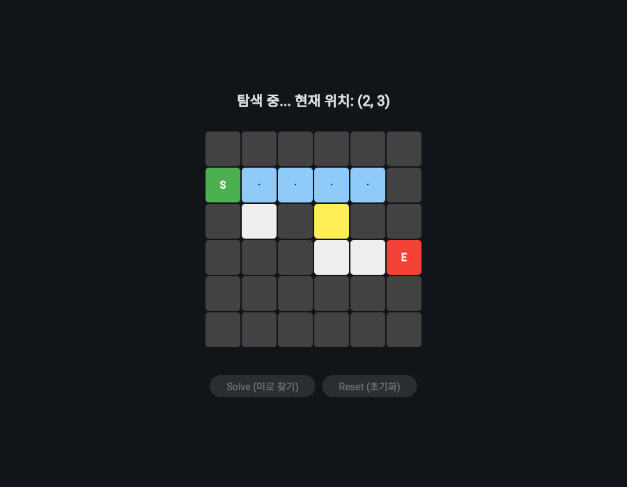 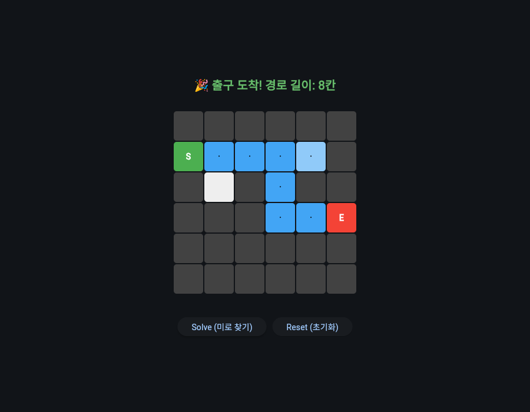

너비 우선 탐색 완료. 막다른 칸 `(1, 4)`, `(2, 1)` 방문 후 8칸 최단 경로 표시.

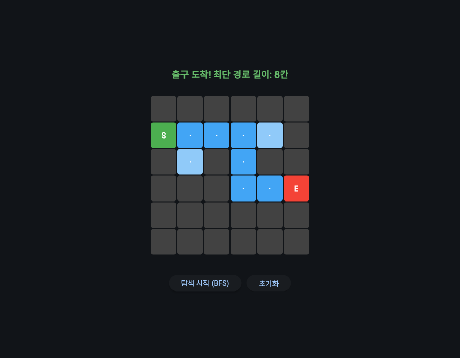

우선순위 탐색 완료. 막다른 칸 방문 없이 출구 도착.

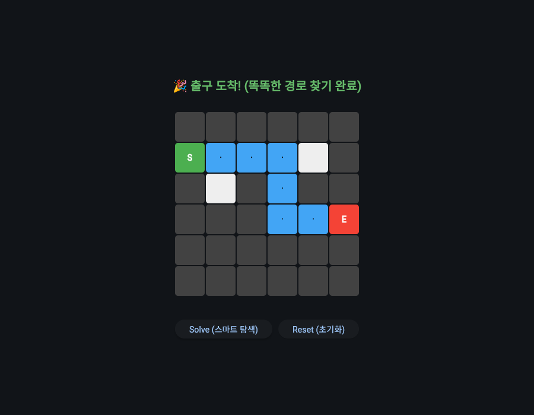

수정 이력

커밋 `c8ddd91`에서 수정한 결함.
- `미로탐색_깊이우선_flet.py`: 방문한 모든 칸을 경로 색으로 칠해 막다른 칸 `(1, 4)`도 경로처럼 표시. 콘솔판과 같이 이전 칸을 기록하고 출구 도착 후 복원한 경로만 진한 파란색으로 표시. 방문한 칸은 연한 파란색
- `미로탐색_너비우선_flet.py`: Flet 0.82.2에 `ft.alignment.center`가 없어 화면 생성 단계에서 오류. 다른 시각화판과 같은 `ft.Alignment.CENTER`로 변경

### 라인 편집기 화면

[`라인편집기_flet.py`](라인편집기_flet.py) · 클래스 `FileIO`, 함수 `main`

콘솔판 `FileIO` 클래스를 옮겨 오고, 출력 메서드 `p()`와 종료 메서드 `q()` 대신 목록 화면과 종료 버튼을 둔 편집기.
줄 번호와 텍스트를 입력창에 넣고 버튼으로 실행.

| 버튼 | 동작 |
|---|---|
| 삽입 | 입력한 줄 번호 자리에 텍스트 삽입. 마지막 줄 다음 번호까지 허용 |
| 수정 | 해당 줄 내용 교체 |
| 삭제 | 해당 줄 삭제 |
| 저장 | 목록을 `text.txt`에 저장. 목록이 비어 있으면 거부 |
| 불러오기 | `text.txt`의 줄을 목록 뒤에 추가한 뒤 화면 갱신 |
| 종료 | 비동기 메서드 `page.window.destroy()`로 창 닫기 |

| 구분 | 콘솔판 `라인편집기.py` | Flet판 `라인편집기_flet.py` |
|---|---|---|
| 명령 입력 | 메서드 호출 | 줄 번호 입력창, 텍스트 입력창, 버튼 6개 |
| 내용 표시 | `p()`가 `print`. 저장된 개행 때문에 줄 사이 빈 줄 | `refresh()`가 `ft.ListView`에 줄 끝 개행을 지우고 표시 |
| 개행 처리 | 호출하는 쪽에서 `\n` 포함 | 입력값 뒤에 `\n` 자동 추가 |
| 줄 번호 검사 | 없음. `d(0)`은 `[:-1]` 음수 슬라이스로 줄이 중복되는 결과 | 정수가 아니거나 1 미만이면 거부. 범위를 넘으면 허용 최대 번호 안내 |
| 빈 텍스트 | 검사 없음 | 삽입과 수정 거부 |
| 파일 없음 | `FileNotFoundError` 발생 | `l()`이 예외를 잡아 안내 문구 반환 |
| 빈 목록 저장 | 빈 파일로 덮어씀 | 저장 거부 |
| 처리 결과 안내 | 없음 | 상태 문구. 성공은 초록, 오류는 붉은색, 삭제는 주황 |

핵심 코드

```python
def on_insert(e):
    n = get_line_no()
    if n is None:
        return
    text = text_field.value
    if not text:
        set_status("텍스트를 입력하세요.", "#f38ba8")
        return
    if n > len(f.line_num) + 1:
        set_status(f"줄 번호가 범위를 벗어났습니다. (최대 {len(f.line_num) + 1})", "#f38ba8")
        return
    f.i(n, text + "\n")
    text_field.value = ""
    refresh()
    set_status(f"{n}번째 줄에 삽입했습니다.")
```

구현 포인트
- 줄 번호 검사를 `get_line_no()` 하나로 모아 줄 번호를 쓰는 세 버튼이 공유. `int()` 변환 실패와 1 미만 값을 같은 `ValueError` 처리로 거부
- 삽입은 마지막 줄 다음 위치까지 허용하고 수정과 삭제는 마지막 줄까지만 허용
- 편집할 때마다 `refresh()`로 목록 화면 전체를 다시 그림. 목록이 비면 내용 없음 문구 표시
- 어두운 배경 `#1e1e2e`에 버튼마다 다른 색 지정

실행 결과

2번째 줄에 삽입한 직후 화면.

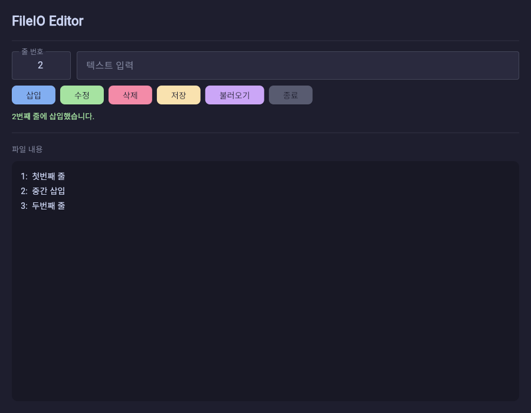

수정 이력
- 종료 버튼이 Flet 0.82.2에 없는 `page.window_destroy()`를 호출해 오류 발생. 처리 함수를 `async def`로 바꾸고 `await page.window.destroy()`로 변경

---

## 실행 방법

콘솔 프로그램

```bash
cd MakeListSet
python -X utf8 원형큐_클래스.py
python -X utf8 미로탐색_너비우선.py
```

- 한글 출력 깨짐 방지를 위해 `-X utf8` 사용
- `원형덱_클래스.py`는 `원형큐_클래스.py`를 import하므로 이 폴더 안에서 실행
- `라인편집기.py`는 실행 위치의 `text.txt`를 덮어씀

Flet 시각화판

```bash
pip install flet==0.82.2
cd MakeListSet
python 미로탐색_깊이우선_flet.py
```
