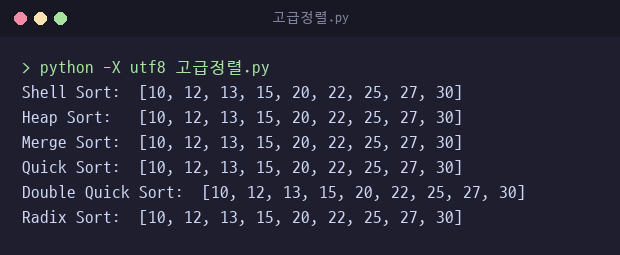
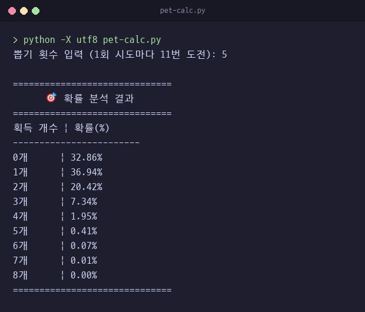
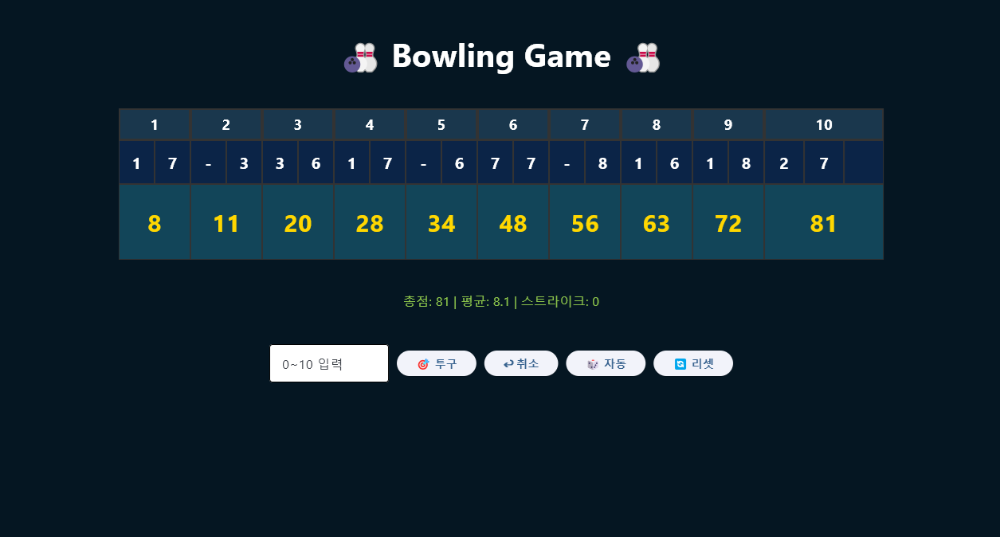

# Practice · 정렬 알고리즘과 응용 프로그램

정렬 6종과 그래프, 확률 시뮬레이션, 게임 프로그램을 모은 폴더.
볼링 점수 계산과 숫자 맞히기 게임은 작성본이 여러 개라 작성 순서와 달라진 점을 표로 정리.
콘솔 결과는 Python 3.10에서 이 폴더로 이동해 `python -X utf8 파일명`으로 실행한 출력.

## 목차

1. [알고리즘](#1-알고리즘)
   - [셸 정렬](#셸-정렬)
   - [힙 정렬](#힙-정렬)
   - [병합 정렬](#병합-정렬)
   - [퀵 정렬](#퀵-정렬)
   - [이중 피벗 퀵 정렬](#이중-피벗-퀵-정렬)
   - [기수 정렬](#기수-정렬)
   - [정렬 검증](#정렬-검증)
   - [무방향 그래프](#무방향-그래프)
2. [확률 시뮬레이션](#2-확률-시뮬레이션)
   - [가챠 확률 시뮬레이터](#가챠-확률-시뮬레이터)
3. [게임과 응용 프로그램](#3-게임과-응용-프로그램)
   - [볼링 점수 계산](#볼링-점수-계산)
   - [숫자 맞히기 게임](#숫자-맞히기-게임)
   - [가위바위보](#가위바위보)
   - [계산기](#계산기)
4. [기초 문법](#4-기초-문법)

---

## 1. 알고리즘

[`고급정렬.py`](고급정렬.py) 한 파일에 정렬 6종을 함수로 구현.
비교 기반 정렬 5종과, 값끼리 비교하지 않고 자릿수로 분배하는 기수 정렬 1종으로 구성.

| 함수 | 정렬 | 원본 리스트 |
|---|---|---|
| `shell_sort` | 셸 정렬 | 제자리 정렬 후 같은 리스트 반환 |
| `heap_sort` | 힙 정렬 | 제자리 정렬 후 같은 리스트 반환 |
| `merge_sort` | 병합 정렬 | 그대로 두고 새 리스트 반환 |
| `quick_sort` | 퀵 정렬 | 그대로 두고 새 리스트 반환 |
| `double_quick_sort` | 이중 피벗 퀵 정렬 | 그대로 두고 새 리스트 반환 |
| `radix_sort` | 기수 정렬 | 그대로 두고 새 리스트 반환 |

### 셸 정렬

[`고급정렬.py`](고급정렬.py) · 함수 `shell_sort(arr)`

간격 `gap`을 리스트 길이의 절반에서 시작해 반씩 줄이며, 간격만큼 떨어진 원소끼리 삽입 정렬.
간격이 1인 마지막 단계는 일반 삽입 정렬과 같음.

핵심 코드

```python
def shell_sort(arr):
    n = len(arr)
    gap = n // 2
    while gap > 0:
        for i in range(gap, n):
            temp = arr[i]
            j = i
            while j >= gap and arr[j - gap] > temp:
                arr[j] = arr[j - gap]
                j -= gap
            arr[j] = temp
        gap //= 2
    return arr
```

구현 포인트
- 원소를 매번 교환하지 않고 `temp`에 빼 둔 뒤 더 큰 원소를 `gap` 칸 뒤로 밀고, 비게 된 자리에 한 번만 기록.
- 큰 간격 단계에서 멀리 떨어진 원소를 먼저 옮겨 두어 간격 1 단계의 이동 거리를 줄이는 방식.
- 전달받은 리스트를 제자리에서 바꾸므로 테스트 코드는 `arr.copy()`를 넘겨 다른 정렬과 같은 입력 유지.

### 힙 정렬

[`고급정렬.py`](고급정렬.py) · 함수 `heap_sort(arr)`, 내부 함수 `heapify(arr, n, i)`

리스트를 완전 이진 트리로 보고 최대 힙을 만든 뒤, 루트의 최댓값을 끝으로 보내고 남은 구간을 다시 힙으로 만드는 과정 반복.

핵심 코드

```python
def heapify(arr, n, i):
    largest = i
    left = 2 * i + 1
    right = 2 * i + 2
    if left < n and arr[left] > arr[largest]:
        largest = left
    if right < n and arr[right] > arr[largest]:
        largest = right
    if largest != i:
        arr[i], arr[largest] = arr[largest], arr[i]
        heapify(arr, n, largest)
```

```python
for i in range(n // 2 - 1, -1, -1):
    heapify(arr, n, i)
for i in range(n - 1, 0, -1):
    arr[0], arr[i] = arr[i], arr[0]
    heapify(arr, i, 0)
```

구현 포인트
- 노드 `i`의 자식 위치를 `2 * i + 1`, `2 * i + 2`로 계산해 별도 트리 구조 없이 리스트 인덱스만 사용.
- 힙 구성은 자식이 있는 마지막 노드 `n // 2 - 1`부터 루트까지 거꾸로 `heapify` 호출.
- 추출 단계에서 `heapify(arr, i, 0)`의 힙 크기 `i`를 하나씩 줄여, 끝으로 보낸 최댓값은 다시 비교하지 않음.
- `heapify`는 자식과 교환한 뒤 내려간 위치에서 재귀 호출.

### 병합 정렬

[`고급정렬.py`](고급정렬.py) · 함수 `merge_sort(arr)`

`mid = len(arr) // 2` 기준으로 리스트를 슬라이싱해 양쪽을 재귀 정렬한 뒤, 두 결과의 앞 원소를 비교해 작은 값부터 새 리스트 `result`에 병합.

핵심 코드

```python
left = merge_sort(arr[:mid])
right = merge_sort(arr[mid:])

result = []
i = j = 0
while i < len(left) and j < len(right):
    if left[i] <= right[j]:
        result.append(left[i])
        i += 1
    else:
        result.append(right[j])
        j += 1
result.extend(left[i:])
result.extend(right[j:])
return result
```

구현 포인트
- 비교에 `<=`를 써서 같은 값은 왼쪽 원소가 먼저 들어가 입력 순서 유지.
- 한쪽 리스트가 끝나면 남은 원소를 `extend()`로 한 번에 이어 붙임.
- 슬라이싱과 `result`로 새 리스트를 만들어 원본은 그대로 두므로, 셸·힙 정렬과 달리 반환값을 받아 사용.

### 퀵 정렬

[`고급정렬.py`](고급정렬.py) · 함수 `quick_sort(arr, pivot_index=None)`

가운데 원소를 피벗으로 정하고 리스트 컴프리헨션으로 구간을 나눔.
피벗보다 작은 값과 큰 값만 재귀 정렬하고, 피벗과 같은 값은 가운데에 그대로 두어 이어 붙임.

핵심 코드

```python
def quick_sort(arr, pivot_index=None):
    if len(arr) <= 1:
        return arr

    if pivot_index is None:
        pivot = arr[len(arr) // 2]
    else:
        pivot = arr[pivot_index]

    left = [x for x in arr if x < pivot]
    mid = [x for x in arr if x == pivot]
    right = [x for x in arr if x > pivot]
    return quick_sort(left) + mid + quick_sort(right)
```

구현 포인트
- 피벗과 같은 값을 `mid`에 모아 재귀에서 제외. 중복 값이 많아도 같은 값을 반복해서 나누지 않음.
- 교환 방식의 제자리 분할 대신 새 리스트를 만들어 이어 붙이는 방식. 코드가 짧은 대신 분할 단계마다 리스트를 세 번 순회하고 새 리스트 생성.
- `pivot_index`로 첫 호출의 피벗 위치를 바꿀 수 있지만 재귀 호출에는 넘기지 않아 하위 단계는 항상 가운데 원소 사용.

### 이중 피벗 퀵 정렬

[`고급정렬.py`](고급정렬.py) · 함수 `double_quick_sort(arr, pivot_index1=None, pivot_index2=None)`

첫 원소와 마지막 원소를 두 피벗으로 잡고, 작은 쪽이 `pivot1`이 되도록 맞춘 뒤 다섯 구간으로 분할.

| 구간 | 담는 값 | 재귀 정렬 |
|---|---|---|
| `left` | `pivot1`보다 작은 값 | 예 |
| `p1` | `pivot1`과 같은 값 | 아니요 |
| `mid` | 두 피벗 사이 값 | 예 |
| `p2` | `pivot2`와 같은 값. 두 피벗이 같으면 빈 리스트 | 아니요 |
| `right` | `pivot2`보다 큰 값 | 예 |

핵심 코드

```python
pivot1 = arr[0] if pivot_index1 is None else arr[pivot_index1]
pivot2 = arr[-1] if pivot_index2 is None else arr[pivot_index2]

if pivot1 > pivot2:
    pivot1, pivot2 = pivot2, pivot1

left = [x for x in arr if x < pivot1]
p1 = [x for x in arr if x == pivot1]
mid = [x for x in arr if (x > pivot1 and x < pivot2)]
# 두 피벗이 같으면 p1에 이미 담겨 있으므로 p2는 비움
p2 = [x for x in arr if x == pivot2] if pivot2 != pivot1 else []
right = [x for x in arr if x > pivot2]

return double_quick_sort(left) + p1 + double_quick_sort(mid) + p2 + double_quick_sort(right)
```

구현 포인트
- 피벗 두 개로 재귀 대상 구간을 세 개로 나눔. 피벗과 같은 값은 `p1`, `p2`에 모아 재귀에서 제외.
- 두 피벗을 비교해 작은 값을 `pivot1`로 교환하므로 첫 원소가 마지막 원소보다 커도 구간 조건 유지.
- 퀵 정렬과 같은 새 리스트 생성 방식이라 원본 리스트는 그대로.

수정 이력
- 결함: 두 피벗 값이 같으면 `p1`과 `p2`가 같은 값을 모두 담아 결과에 두 번 포함. `[5, 1, 5]` 결과 `[1, 5, 5, 5, 5]`. 수정 전 정렬 검증 사례에서 460개 불일치
- 수정: 두 피벗이 같으면 `p2`를 빈 리스트로 둠. 수정 후 `[1, 5, 5]`
- 수정 커밋 `c8ddd91`

### 기수 정렬

[`고급정렬.py`](고급정렬.py) · 함수 `radix_sort(arr)`, 내부 함수 `counting_sort_by_digit`, `sort_non_negative`

일의 자리부터 자릿값 `exp`를 10배씩 키우며 `(num // exp) % 10` 번호의 버킷 10개에 분배한 뒤 버킷 순서대로 이어 붙임.
최댓값의 자릿수만큼 반복하고, 값끼리 비교하는 연산은 없음.

핵심 코드

```python
def counting_sort_by_digit(arr, exp):
    buckets = [[] for _ in range(10)]
    for num in arr:
        digit = (num // exp) % 10
        buckets[digit].append(num)
    result = []
    for bucket in buckets:
        result.extend(bucket)
    return result
```

```python
# 음수는 절댓값으로 정렬한 뒤 순서를 뒤집어 양수 앞에 붙임
negatives = sort_non_negative([-x for x in arr if x < 0])
positives = sort_non_negative([x for x in arr if x >= 0])
return [-x for x in reversed(negatives)] + positives
```

구현 포인트
- 함수 이름은 `counting_sort_by_digit`이지만 개수를 세는 배열 대신 버킷 리스트 10개에 원소를 그대로 담는 방식.
- 버킷에 들어온 순서를 유지하므로 낮은 자리에서 정해진 순서가 높은 자리 정렬 뒤에도 유지.
- `max_val // exp`가 0이 되면 반복 종료. 반복 횟수는 최댓값의 자릿수.
- 음수는 부호를 바꿔 따로 정렬한 뒤 순서를 뒤집고 다시 음수로 바꿔 양수 앞에 배치.

수정 이력
- 결함: 음수 미지원. 음수 `-1`의 자릿값 `(-1 // 1) % 10`이 9로 계산되어 양수 뒤 버킷에 들어감. `[3, -1, 2]` 결과 `[2, 3, -1]`. 수정 전 음수 포함 배열에서 455개 불일치
- 수정: 음수와 0 이상 값을 나눠 각각 정렬하는 `sort_non_negative` 추가. 수정 후 `[-1, 2, 3]`
- 수정 커밋 `c8ddd91`

### 정렬 검증

파일 맨 아래 테스트 코드는 같은 배열 `[27, 10, 12, 20, 25, 13, 15, 22, 30]`을 `arr.copy()`로 여섯 함수에 넘겨 결과 출력.



무작위 배열 검증
- 길이 0~40의 무작위 배열 1,800개와 경계 사례 9개, 총 1,809개를 `sorted()` 결과와 비교
- 6종 모두 1,809개 일치. Python 3.10, 3.14 동일

| 값 범위 | 배열 수 | 특징 |
|---|---|---|
| 0~999 정수 | 1,000 | 일반 정수 |
| 0~4 | 300 | 중복 값 위주 |
| -999~999 | 300 | 음수·양수 혼합 |
| -3~3 | 200 | 음수 포함 중복 |

경계 사례 9개에 포함된 예
- 빈 배열
- 원소 1개
- 모두 같은 값
- 결함 재현 사례 `[5, 1, 5]`, `[3, -1, 2]`

### 무방향 그래프

[`graph.py`](graph.py) · 클래스 `Graph`

정점은 집합 `vertices`, 간선은 정점마다 이웃 정점을 담는 인접 리스트 딕셔너리 `edges`로 관리하는 무방향 그래프.

| 메서드 | 동작 |
|---|---|
| `isEmpty()` | 정점이 없으면 True |
| `countVertex()` | 정점 수 |
| `countEdge()` | 모든 인접 리스트 길이 합의 절반 |
| `getEdge(u, v)` | 간선이 있으면 `(u, v)`, 없으면 None |
| `degree(v)` | 인접 리스트 길이 |
| `adjacent(v)` | 인접 정점 집합의 사본 |
| `insertVertex(v)` | 정점 추가와 빈 인접 리스트 생성 |
| `insertEdge(u, v)` | 두 정점이 모두 있을 때 양쪽 인접 리스트에 서로 추가 |
| `deleteVertex(v)` | 정점과 인접 리스트 삭제 후 다른 정점의 리스트에서도 제거 |
| `deleteEdge(u, v)` | 양쪽 인접 리스트에서 서로 제거 |

핵심 코드

```python
def insertEdge(self, u, v):
    if u in self.vertices and v in self.vertices:
        self.edges[u].append(v)
        self.edges[v].append(u)

def deleteVertex(self, v):
    if v in self.vertices:
        self.vertices.remove(v)
        del self.edges[v]
        for u in self.edges:
            if v in self.edges[u]:
                self.edges[u].remove(v)
```

구현 포인트
- 무방향 간선 하나를 양쪽 정점의 인접 리스트에 모두 기록하므로 `countEdge()`는 리스트 길이 합을 2로 나눔.
- 정점 삭제 시 다른 정점의 인접 리스트에서도 지워 끊어진 간선이 남지 않음.
- 없는 정점 사이의 간선 추가는 조건문에서 무시. 같은 간선의 중복 추가는 막지 않아 두 번 넣으면 간선 수와 차수가 2로 집계.
- `adjacent()`는 인접 리스트를 `set`으로 복사해 반환하므로 바깥에서 결과를 바꿔도 내부 리스트는 그대로.

실행 결과

`graph.py`에는 테스트 코드가 없어 단독 실행 시 출력 없음.
아래는 이 폴더에서 클래스를 불러와 확인한 결과.

```python
from graph import Graph

g = Graph()
for v in "ABCD":
    g.insertVertex(v)
g.insertEdge("A", "B")
g.insertEdge("A", "C")
g.insertEdge("B", "D")
print(g.countEdge(), g.degree("A"), sorted(g.adjacent("A")))
g.deleteVertex("A")
print(g.countVertex(), g.countEdge())
```

```text
3 2 ['B', 'C']
3 1
```

간선 `A-B`·`A-C`·`B-D`에서 간선 수 3, A의 차수 2. A 삭제 후 정점 3개, 간선 수 1.

---

## 2. 확률 시뮬레이션

### 가챠 확률 시뮬레이터

[`pet-calc.py`](pet-calc.py) · 실험본 [`pet.py`](pet.py)

게임 뽑기에서 특정 아이템을 몇 개 얻을지의 확률 분포를 몬테카를로 시뮬레이션으로 계산하는 프로그램.

제작 목적
- 몇 번 뽑으면 몇 개 정도 얻는지 직관적으로 확인
- 확률이 낮은 이벤트에서 체감 확률과 실제 확률의 차이 확인

작동 방식
- 1회 뽑기 = 11번 시도
- 시도마다 `single_prob` 2% 확률로 당첨
- 입력한 횟수 n에 대해 총 `11 × n`번 시도
- 이 과정을 `trials` 1,000,000번 반복해 획득 개수별 비율 계산
- `max_pet` 8개까지 집계

핵심 코드

```python
counts = [0] * (max_pet + 1)

for _ in range(trials):
    pets = 0

    # 총 뽑기 횟수 = 11 * n
    for _ in range(n * 11):
        if pets < max_pet and random.random() < single_prob:
            pets += 1

    counts[pets] += 1

# 확률 계산
probabilities = [c / trials * 100 for c in counts]
```

구현 포인트
- 획득 개수를 인덱스로 쓰는 리스트 `counts`에 반복마다 1을 더하고, 마지막에 반복 횟수로 나눠 백분율 계산.
- `pets < max_pet` 조건으로 8개에 도달하면 더 세지 않으므로 마지막 칸은 8개 이상을 합친 값.
- 1회 뽑기를 11번 시도로 묶어 입력은 묶음 횟수 n만 받음.

결과 해석
- 각 값은 해당 개수를 얻을 확률
- 기댓값뿐 아니라 운이 좋거나 나쁠 확률까지 분포로 확인 가능
- n = 5 실행 결과 0개 32.86%. 55번 모두 실패할 이론값 0.98⁵⁵ ≈ 32.9%와 일치

시도 55번, 당첨 확률 2%의 이항분포 계산값과 비교

| 획득 개수 | 시뮬레이션 | 이항분포 계산값 |
|---|---|---|
| 0개 | 32.86% | 32.92% |
| 1개 | 36.94% | 36.95% |
| 2개 | 20.42% | 20.36% |
| 3개 | 7.34% | 7.34% |
| 4개 | 1.95% | 1.95% |
| 5개 | 0.41% | 0.41% |
| 6개 | 0.07% | 0.07% |
| 7개 | 0.01% | 0.01% |
| 8개 이상 | 0.00% | 0.00% |

실행 결과, n = 5



기존 실행 화면


실험본 [`pet.py`](pet.py)는 당첨 확률 3%로 시도 5번, 11번, 44번을 이어서 진행할 때 최대 3개까지의 획득 수를 기록.
반복마다 획득 수를 리스트에 모아 한 번에 출력.

사용 기술
- Python `random` 모듈
- 몬테카를로 시뮬레이션

---

## 3. 게임과 응용 프로그램

### 볼링 점수 계산

대표 작성본 [`Bowlingfletcomplete.py`](Bowlingfletcomplete.py) · 클래스 `BowlingGame`

투구한 핀 수를 리스트 `throw_list`에 순서대로 쌓고, 투구마다 프레임별 누적 점수를 처음부터 다시 계산하는 볼링 점수판.
콘솔판과 Flet 화면판 작성본이 함께 있음.

| 결과 | 조건 | 프레임 점수 |
|---|---|---|
| 스트라이크 | 첫 투구에 10핀 | 10 + 다음 두 투구 |
| 스페어 | 두 투구 합 10핀 | 10 + 다음 한 투구 |
| 오픈 | 두 투구 합 10핀 미만 | 두 투구 합 |
| 10프레임 | 스트라이크나 스페어면 세 번째 투구 허용 | 최대 세 투구 합 |

작성본

순서는 git 기록의 파일별 첫 커밋 기준이며, 같은 커밋에 함께 올라간 파일은 파일명 순서.

| 순서 | 파일 | 형태 | 달라진 점 |
|---|---|---|---|
| 1 | [`bowling.py`](bowling.py) | 콘솔, 무작위 투구 | 투구 기록 없이 누적 점수만 관리. 스트라이크 뒤 두 프레임, 스페어 뒤 한 프레임의 점수 합을 두 배로 더하는 방식이라 실제 규칙과 다름. 코드 주석에 잘못된 계산법이라고 기록 |
| 2 | [`bowling2.py`](bowling2.py) | Flet | 첫 커밋 때는 `BowlingGame.py`의 바탕이 된 콘솔판이었고 이후 Flet판으로 교체. 투구 목록을 `build_frames`로 프레임 단위 리스트로 나눈 뒤 점수 계산과 표시 변환에 사용 |
| 3 | [`bowling_final.py`](bowling_final.py) | 콘솔, 자동 진행 | 첫 커밋 때는 함수로만 구성한 입력판이었고 이후 클래스 자동 진행판으로 교체. 프레임마다 입력을 기다린 뒤 `random.randint`로 핀 수를 정하고 `time.sleep(1.5)` 간격으로 전광판 출력 |
| 4 | [`BowlingGame.py`](BowlingGame.py) | 콘솔, 사용자 입력 | 첫 커밋 때의 `bowling2.py`를 복사해 만든 파일. 투구를 `throw_list`에 쌓고 투구마다 전체 점수를 다시 계산하는 `BowlingGame` 클래스. 이후 0핀 투구를 `-`로 표시하도록 표시 함수 수정. 파일 머리 주석에 점수 계산 설계 메모 |
| 5 | [`bowling_automation.py`](bowling_automation.py) | 콘솔, 자동 진행 | `bowling_final.py`를 복사한 뒤 안내 문구를 Enter 입력으로 바꾸고 10프레임 시작 전에도 입력 대기 추가 |
| 6 | [`Bowling_flet.py`](Bowling_flet.py) | Flet | `bowling_func.py`의 클래스를 불러와 프레임 번호와 투구 칸, 누적 점수를 프레임마다 세로 한 칸으로 묶은 점수판. 10프레임 칸만 넓게 배치 |
| 7 | [`bowling_func.py`](bowling_func.py) | 클래스 모듈 | 실행 코드 없이 `BowlingGame` 클래스만 둔 파일. 10프레임 표시에 프레임 안 투구 순번 `roll_in_frame` 추가 |
| 8 | [`Bowlingfletcomplete.py`](Bowlingfletcomplete.py) | Flet | 최종판. 투구 유효성 검사와 10프레임 전용 점수 분기 추가. Undo·Auto·Reset 버튼 |
| 9 | [`Bowlingfletcomplete_class.py`](Bowlingfletcomplete_class.py) | 클래스 모듈 | 최종판 첫 커밋에서 불러 쓰던 클래스 파일. 이후 최종판이 클래스를 파일 안에 포함하면서 쓰이지 않음. 유효성 검사는 프레임 첫 투구와의 합만 확인 |

핵심 코드, `Bowlingfletcomplete.py`의 `calculate_live_scores` 중 1~9프레임

```python
if frame < 9:
    if tl[i] == 10: # 스트라이크
        if i + 2 < len(tl):
            total += 10 + tl[i+1] + tl[i+2]
            scores.append(total)
            i += 1
        else: break
    elif i + 1 < len(tl):
        if tl[i] + tl[i+1] == 10: # 스페어
            if i + 2 < len(tl):
                total += 10 + tl[i+2]
                scores.append(total)
                i += 2
            else: break
```

스트라이크는 다음 두 투구, 스페어는 다음 한 투구가 들어올 때까지 `break`로 점수 계산을 미룸.
오픈 프레임은 이어지는 `else` 분기에서 두 투구 합을 바로 더함.

같은 함수의 10프레임 분기

```python
else: # 10프레임
    if i + 1 < len(tl):
        if tl[i] + tl[i+1] >= 10:
            if i + 2 < len(tl):
                total += tl[i] + tl[i+1] + tl[i+2]
                scores.append(total)
                i += 3
            else: break
        else:
            total += tl[i] + tl[i+1]
            scores.append(total)
            i += 2
    else: break
```

구현 포인트
- 인덱스 `i`를 스트라이크면 1칸, 그 외에는 2칸 옮겨 프레임 시작 위치를 추적. 보너스 투구가 아직 없으면 멈추므로 점수가 확정된 프레임까지만 누적 점수 표시.
- 10프레임은 두 투구 합이 10 이상이면 세 투구 합을 더하는 별도 분기. 콘솔판 `BowlingGame.py`는 이 분기 없이 같은 규칙을 열 번 반복하는데, 보너스 투구가 같은 리스트 뒤에 붙어 있어 결과가 같음. 두 방식 모두 아래 167점 예시와 12번 연속 스트라이크의 300점 확인.
- 콘솔판 10프레임 입력은 첫 투구가 스트라이크면 두 번째 투구 범위를 0~10으로 넓히고, 스트라이크나 스페어일 때만 보너스 투구 질문.

`is_valid_roll`은 현재 투구가 속한 프레임을 찾은 뒤 아래 경우의 투구를 거부.

| 위치 | 거부 조건 |
|---|---|
| 1~9프레임 두 번째 투구 | 첫 투구와 합이 10 초과 |
| 10프레임 두 번째 투구 | 첫 투구가 스트라이크가 아닌데 합이 10 초과 |
| 10프레임 세 번째 투구 | 두 투구 합이 10 미만이라 보너스 없음 |
| 10프레임 세 번째 투구 | 첫 투구 스트라이크 뒤 두 번째가 10 미만인데 두 번째와 합이 10 초과 |

화면 기능
- Undo: 마지막 투구를 `pop()`으로 지우고 점수판 다시 그림
- Auto: 0~10 무작위 값 중 `is_valid_roll`을 통과한 값으로 투구, 최대 50번 시도
- Reset: 투구 목록 비움
- 점수판 아래 총점과 프레임 평균, 스트라이크 수 표시
- 점수가 아직 확정되지 않은 첫 프레임 번호 칸을 주황색으로 강조

실행 결과

`BowlingGame.py` 콘솔판. 핀 수 `10, 7, 3, 9, 0, 10, 0, 8, 8, 2, 0, 6, 10, 10, 10, 8, 1`을 차례로 입력한 뒤의 마지막 전광판.

```text
======================================
프레임: ❌ | 7 / | 9 - | ❌ | - 8 | 8 / | - 6 | ❌ | ❌ | ❌ 8 1
점수  :  20 |  39 |  48 |  66 |  74 |  84 |  90 | 120 | 148 | 167
======================================

최종 점수 : 167점
```

`Bowlingfletcomplete.py` 화면. 9프레임 스페어 `4 /`에 10프레임 첫 투구 4가 보너스로 더해져 50에서 64, 10프레임 오픈 `4 -`로 최종 68.



### 숫자 맞히기 게임

대표 작성본 [`UPDOWN_5.py`](UPDOWN_5.py) · 함수 `main(page)`, 내부 함수 `check_number`, `restart_game`

1부터 100 사이 무작위 정답과 입력값을 비교해 더 높은지 낮은지 안내하는 게임.
tkinter 화면 시도, 콘솔판 세 개, Flet 화면판 순서로 작성.

작성본

순서는 파일별 첫 커밋 기준. `UPDOWN_1.py`와 `UPDONW_2.py`, `UPDOWN_4.py`와 `UPDOWN_5.py`는 각각 같은 커밋에 올라가 파일명 번호 순서.

| 순서 | 파일 | 형태 | 달라진 점 |
|---|---|---|---|
| 1 | [`UPDOWN_1.py`](UPDOWN_1.py) | tkinter | 입력창과 버튼 등 창 구성 요소만 배치한 첫 작성본. 버튼 동작은 미연결 |
| 2 | [`UPDONW_2.py`](UPDONW_2.py) | 콘솔 | 정답과 비교해 더 큰 수나 작은 수 안내. 정답 후 Y·N이 들어올 때까지 다시 묻는 입력 검사 반복문 |
| 3 | [`UPDOWN_3.py`](UPDOWN_3.py) | 콘솔 | 기회 5번 제한 추가. 틀릴 때마다 남은 기회를 출력하고 정답이나 기회 소진 시 종료 |
| 4 | [`UPDOWN_4.py`](UPDOWN_4.py) | 콘솔 | 기회 제한과 재시작 결합. 정답과 기회 소진 두 경우 모두 y·n 확인 후 새 정답과 기회 5번으로 초기화 |
| 5 | [`UPDOWN_5.py`](UPDOWN_5.py) | Flet | 4번 규칙을 화면으로 옮김. 확인·다시 시작 버튼과 숫자가 아닌 입력 안내 추가 |

핵심 코드, `UPDOWN_5.py`

```python
def check_number(e):
    nonlocal ran_num, a

    try:
        n = int(input_box.value)  # 입력 숫자
    except:
        result_text.value = "숫자를 입력해주세요."
        page.update()
        return

    # 정답 맞춘 경우
    if n == ran_num:
        result_text.value = "정답입니다."
        chance_text.value = "다시 시작 버튼을 눌러주세요."
```

틀리면 남은 기회 `a`를 1 줄이고 크기 비교 결과 표시. `a`가 1보다 작아지면 정답을 공개하고 다시 시작 버튼 안내.

구현 포인트
- Flet 이벤트 함수 안에서 바깥 `main`의 정답과 남은 기회를 바꾸기 위해 `nonlocal` 선언.
- `int()` 변환을 `try`로 감싸 숫자가 아닌 입력은 기회 차감 없이 안내 문구만 표시.
- 콘솔판 `UPDOWN_4.py`는 y나 n이 들어올 때까지 다시 묻고, y면 `ran_num_imp()`로 새 정답을 뽑고 기회를 5번으로 되돌림.

실행 결과

`UPDOWN_4.py` 콘솔판. 한 번 틀린 뒤 정답 입력, 재시작 질문에 n 입력.

```text
67
숫자를 입력해주세요. : 74
더 낮은 숫자를 입력해주세요. 
기회가  4 번 남으셨습니다.
67
숫자를 입력해주세요. : 67
정답입니다.
다시 시작하려면 y,nn
프로그램이 종료됩니다.
```

입력 전 줄마다 정답 67이 보이는 것은 코드에 남은 확인용 `print(ran_num)` 출력.

수정 이력
- `UPDONW_2.py`는 N을 입력하면 종료 문구를 출력한 뒤에도 바깥 반복문이 새 게임을 시작해 프로그램이 끝나지 않음. 재시작은 안쪽 반복문에서 새 정답을 뽑아 처리하므로 바깥 반복문을 없애 N 입력 시 종료

### 가위바위보

[`RSP.py`](RSP.py) · 함수 `main(page)`, 내부 함수 `play(user_choice)`, `reset_game`

Flet 화면의 바위·가위·보 버튼으로 컴퓨터와 대결하는 게임.
3점을 먼저 얻으면 세트 1개, 세트 3개를 먼저 얻으면 게임 종료.

| 변수 | 뜻 |
|---|---|
| `u_score`, `c_score` | 현재 세트의 유저·컴퓨터 점수 |
| `set_u`, `set_c` | 유저·컴퓨터가 딴 세트 수 |

핵심 코드

```python
if user_choice == computer:
    result = "무승부"

elif (user_choice == 0 and computer == 1) or \
     (user_choice == 1 and computer == 2) or \
     (user_choice == 2 and computer == 0):
    result = "유저 승리"
    u_score += 1

else:
    result = "컴퓨터 승리"
    c_score += 1
```

구현 포인트
- `choices` 인덱스 0은 바위, 1은 가위, 2는 보. 유저가 이기는 세 조합을 조건식으로 나열하고, 같으면 무승부, 나머지는 컴퓨터 승리.
- 버튼마다 `lambda e: play(0)` 형태로 선택 번호를 넘겨 판정 함수 하나를 공유.
- 3점 도달 시 세트 수를 올리고 현재 점수를 0으로 초기화. 세트 3개 도달 시 버튼을 `disabled`로 막고, 다시 시작 버튼이 점수 초기화와 버튼 활성화를 함께 처리.

### 계산기

[`Calculator.py`](Calculator.py) · 함수 `calc(event)`

tkinter 입력창에 식을 쓰고 Enter 키를 누르면 `eval()`로 계산한 결과를 라벨에 `Total: 결과` 형태로 표시.

핵심 코드

```python
def calc(event):
    label.config(text="Total: "+str(eval(entry.get())))
```

```python
label = Label(root, text="0") #레이블 생성
label.pack() #화면에 배치

entry = Entry(root, width=30)
entry.bind("<Return>", calc)
entry.pack()
```

구현 포인트
- 버튼 없이 `entry.bind("<Return>", calc)`로 Enter 키 이벤트에 계산 함수 연결. 이벤트로 호출되므로 `event` 인자를 받는 형태.
- 연산자 우선순위와 괄호 처리는 파이썬 `eval()`에 맡김. 후위 표기 변환으로 계산하는 [`수식계산기.py`](../MakeListSet/수식계산기.py)와 대비되는 방식.
- 잘못된 식에 대한 예외 처리가 없고, `eval()`은 입력 문자열을 코드로 실행하므로 계산식이 아닌 입력도 그대로 실행.

---

## 4. 기초 문법

| 파일 | 주제 | 내용 |
|---|---|---|
| [`Test.py`](Test.py) | 변수 범위와 조건문 | 중첩 함수의 `global a` 대입이 모듈 변수까지 바꿔 `a = 30`이 세 번 출력. 입력한 숫자는 중첩 `if`로 양수와 0, 음수 판별 |
| [`Test2.py`](Test2.py) | `while` 반복과 `break` | 1부터 입력값 n까지 합산. n이 10보다 크면 첫 반복 뒤 `break`로 멈춰 합계 1 |
| [`Test3.py`](Test3.py) | 형변환 | 문자열 `"456"`을 `int()`로 바꿔 정수 123과 더한 결과 579와 각 자료형 출력 |
| [`Test4.py`](Test4.py) | 함수와 매개변수 | `return`이 있는 절댓값 함수와 기본값 매개변수 사용. 함수 안 `x=10`이 바깥 `x=20`을 바꾸지 않음을 출력으로 확인 |
| [`write.py`](write.py) | 파일 입출력 | `with open()`으로 세 줄을 쓴 뒤 다시 열어 `read(4)`로 네 글자씩 읽고 `tell()`·`seek(0)`로 위치 이동. 실행 위치에 `test.txt` 생성 |
| [`errortest.py`](errortest.py) | Flet 버튼 이벤트 | 버튼을 누르면 콘솔에 메시지를 출력하고 화면에 `Text` 추가 |

`Test.py`부터 `Test4.py`까지는 이전에 연습한 코드나 오류가 나는 예제를 삼중 따옴표 문자열로 감싸 실행에서 제외한 구조.
