# Python 자료구조와 알고리즘

자료구조와 알고리즘을 파이썬 리스트와 클래스만으로 구현한 학습 저장소.
`collections`·`heapq`·`queue` 같은 표준 자료구조 모듈 미사용.
항목 이름을 누르면 코드 설명, 핵심 코드, 실행 결과를 정리한 폴더 README로 이동.

## 폴더 구성

| 폴더 | 내용 | 상세 문서 |
|---|---|---|
| [`MakeListSet`](MakeListSet) | 자료구조 구현, 자료구조 응용, Flet 시각화판 | [MakeListSet README](MakeListSet/README.md) |
| [`Practice`](Practice) | 정렬 6종, 그래프, 확률 시뮬레이션, 게임 | [Practice README](Practice/README.md) |
| [`flet`](flet) | Flet 응용 프로그램과 화면 구성 | [flet README](flet/README.md) |
| [`Python GUI`](Python%20GUI) | tkinter 위젯, 콘솔 가위바위보 | [Python GUI README](Python%20GUI/README.md) |
| [`Flask`](Flask) | `/` 경로에 Hello, World! 응답 하나만 있는 Flask 시작 예제 | [`app.py`](Flask/app.py) |

---

## 1. 자료구조

같은 자료구조를 배열 방식과 연결 방식으로 각각 구현해 차이 비교.

| 구조 | 배열 방식 | 연결 방식 |
|---|---|---|
| 리스트 | [배열 리스트](MakeListSet/README.md#배열-리스트) | [연결 리스트](MakeListSet/README.md#연결-리스트) · [연결 리스트 클래스](MakeListSet/README.md#연결-리스트-클래스) |
| 스택 | [배열 스택](MakeListSet/README.md#배열-스택) | [연결 스택](MakeListSet/README.md#연결-스택) |
| 큐 | [선형 큐](MakeListSet/README.md#선형-큐) · [원형 큐](MakeListSet/README.md#원형-큐) | [연결 큐](MakeListSet/README.md#연결-큐) |
| 덱 | [선형 덱](MakeListSet/README.md#선형-덱) · [원형 덱](MakeListSet/README.md#원형-덱) | |
| 우선순위 큐 | [우선순위 큐](MakeListSet/README.md#우선순위-큐) | |
| 집합 | [배열 집합](MakeListSet/README.md#배열-집합) | [연결 집합](MakeListSet/README.md#연결-집합) |

- 원형 덱은 원형 큐 클래스를 상속해 공백·포화 판정과 개수 계산을 재사용
- 실행 중 발견한 결함과 수정 내용은 [결함 수정 이력](MakeListSet/README.md#결함-수정-이력)에 정리

실행 결과

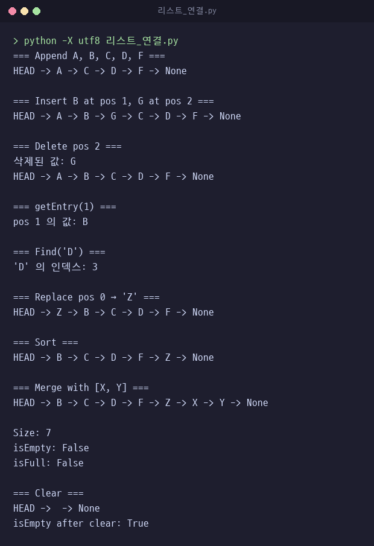 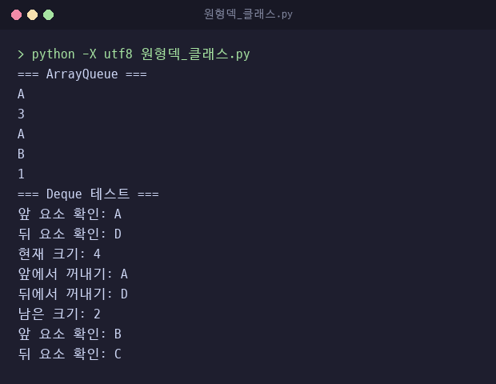

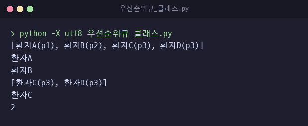 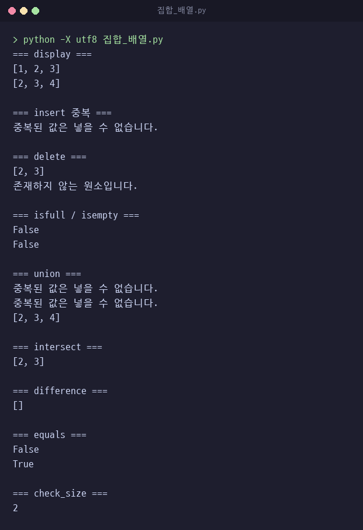

## 2. 알고리즘

### 정렬

[`Practice/고급정렬.py`](Practice/고급정렬.py) 한 파일에 함수로 구현.

| 정렬 | 방식 |
|---|---|
| [셸 정렬](Practice/README.md#셸-정렬) | 간격을 절반씩 줄이며 간격 단위 삽입 정렬 |
| [힙 정렬](Practice/README.md#힙-정렬) | 최대 힙 구성 후 루트를 끝으로 보내는 과정 반복 |
| [병합 정렬](Practice/README.md#병합-정렬) | 절반씩 재귀 분할 후 병합 |
| [퀵 정렬](Practice/README.md#퀵-정렬) | 가운데 피벗 기준 세 구간 분할 |
| [이중 피벗 퀵 정렬](Practice/README.md#이중-피벗-퀵-정렬) | 첫 원소와 마지막 원소를 두 피벗으로 다섯 구간 분할 |
| [기수 정렬](Practice/README.md#기수-정렬) | 일의 자리부터 자릿수별 버킷 분배 |

[정렬 검증](Practice/README.md#정렬-검증): 무작위 배열과 경계 사례를 `sorted()` 결과와 대조해 6종 모두 일치 확인.

실행 결과

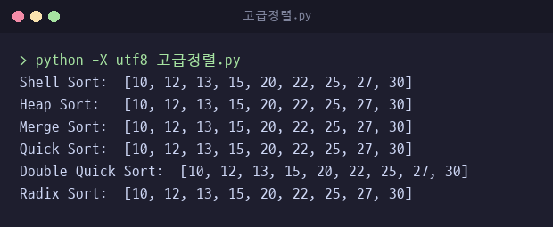

### 미로 탐색

같은 미로에서 다음에 방문할 칸을 고르는 자료구조만 바꿔 비교. [세 방식 비교표](MakeListSet/README.md#미로-탐색-비교)

| 탐색 | 사용 구조 | 특징 |
|---|---|---|
| [깊이 우선](MakeListSet/README.md#깊이-우선-미로-탐색) | 스택 | 한 갈래를 끝까지 들어간 뒤 되돌아감. 이전 칸 기록으로 경로 복원 |
| [너비 우선](MakeListSet/README.md#너비-우선-미로-탐색) | 큐 | 가까운 칸부터 퍼져 최단 경로 보장 |
| [우선순위](MakeListSet/README.md#우선순위-미로-탐색) | 우선순위 큐 | 출구까지 거리가 가장 짧은 칸부터 방문 |

실행 결과

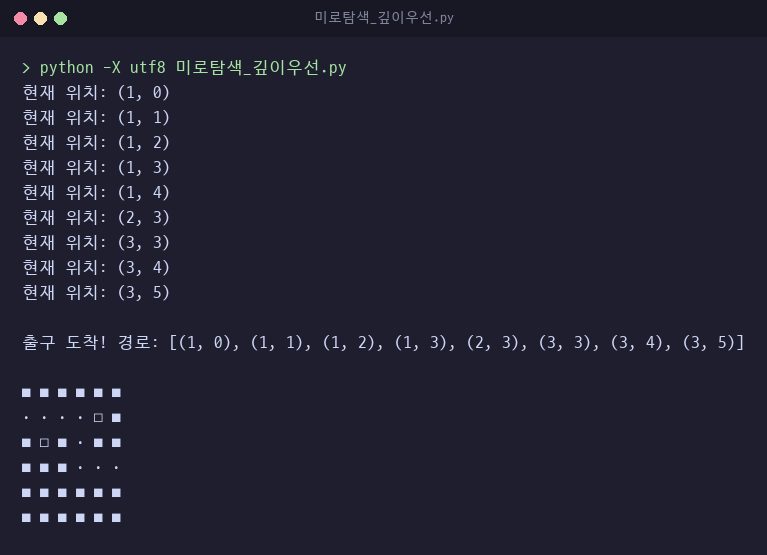 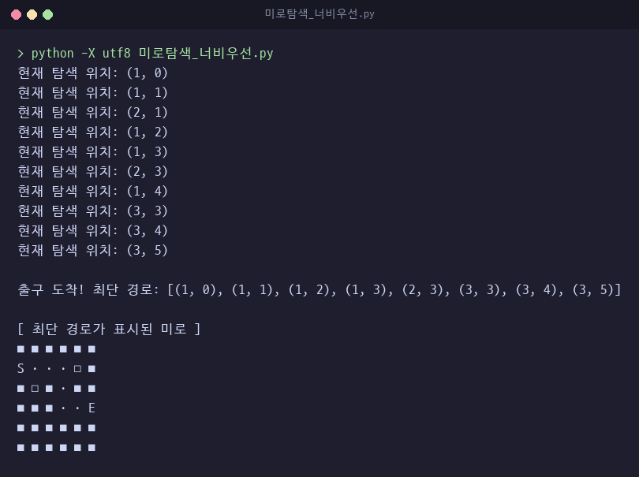

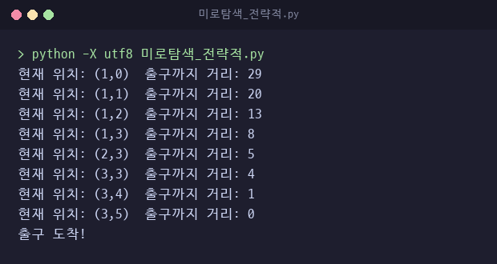

### 그래프

[무방향 그래프](Practice/README.md#무방향-그래프): 정점 집합과 인접 리스트 딕셔너리로 정점·간선 추가와 삭제, 차수 계산.

## 3. 자료구조 응용

| 프로그램 | 사용 구조 | 내용 |
|---|---|---|
| [괄호 검사](MakeListSet/README.md#괄호-검사) | 스택 | 여는 괄호를 쌓고 닫는 괄호와 짝 비교 |
| [수식 계산기](MakeListSet/README.md#수식-계산기) | 스택 | 중위 표기식을 후위 표기식으로 바꾼 뒤 계산 |
| [라인 편집기](MakeListSet/README.md#라인-편집기) | 리스트 | 줄 번호 기반 삽입·삭제·교체, 파일 저장과 불러오기 |

실행 결과

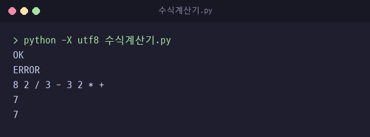 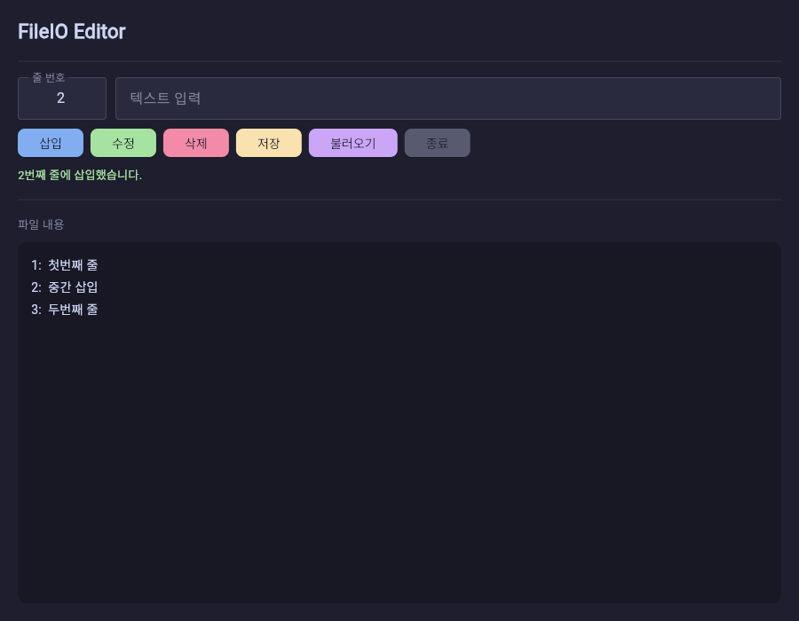

## 4. 화면 프로그램

### Flet 시각화

콘솔 알고리즘을 Flet 화면으로 옮겨 탐색 과정을 한 칸씩 표시.

| 화면 | 내용 |
|---|---|
| [미로 탐색 화면](MakeListSet/README.md#미로-탐색-화면) | 비동기 대기로 탐색 중인 칸과 방문한 칸, 복원한 경로를 색으로 구분 |
| [수식 계산기 화면](MakeListSet/README.md#수식-계산기-화면) | 버튼 패드와 키보드 입력, 괄호 오류와 수식 오류 구분 표시 |
| [라인 편집기 화면](MakeListSet/README.md#라인-편집기-화면) | 줄 번호 범위 검사와 처리 결과 안내 |

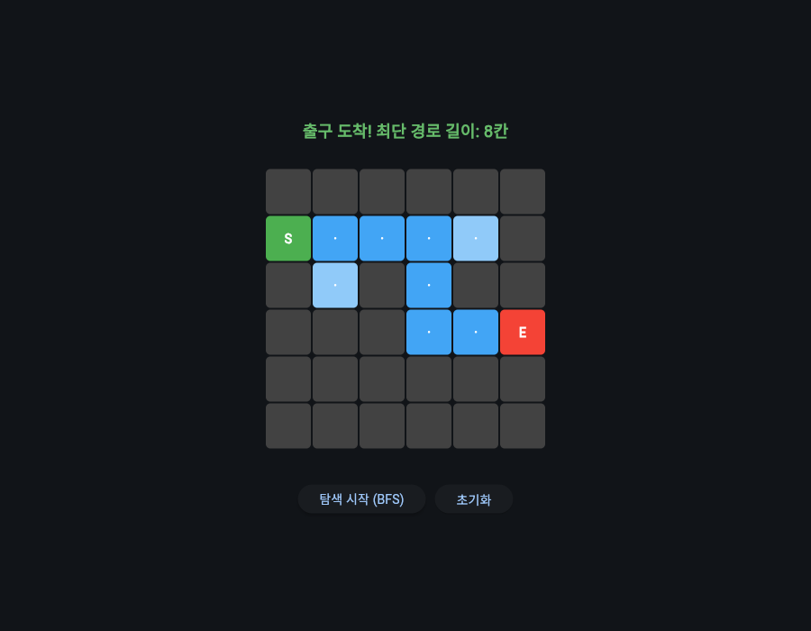 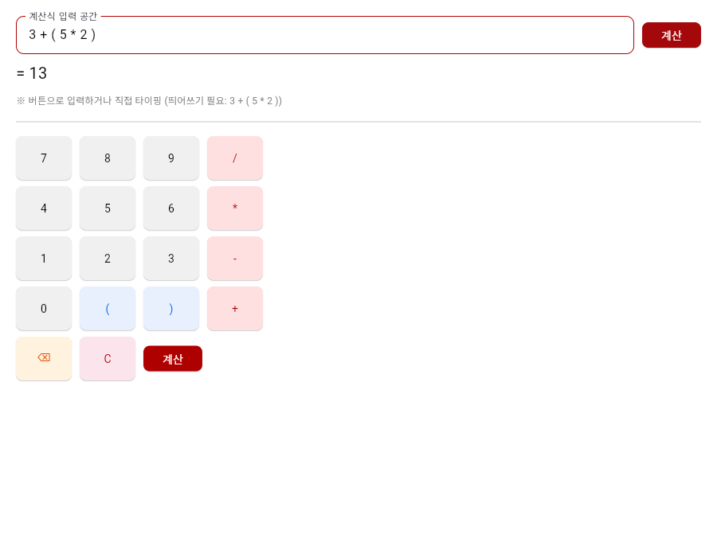

### Flet 응용 프로그램

| 프로그램 | 내용 |
|---|---|
| [상점 관리](flet/README.md#상점-관리) | 재고·가격 JSON 저장, 무작위 할인, 재고 부족 경고, 관리자 모드, 영수증 기록 |
| [전화번호부](flet/README.md#전화번호부) | CSV 저장, 연락처 추가·수정·삭제·검색 |
| [다중 숫자 계산기](flet/README.md#다중-숫자-계산기) | 여러 정수의 사칙연산과 평균·최댓값·최솟값 |
| [볼링 점수 화면](flet/README.md#볼링-점수-화면) | 투구 기록 기반 프레임 표기와 누적 점수 |
| [화면 구성 연습](flet/README.md#2-화면-구성-연습) | 라벨 겹침 상자, 관제 대시보드 화면 시안 |

실행 화면

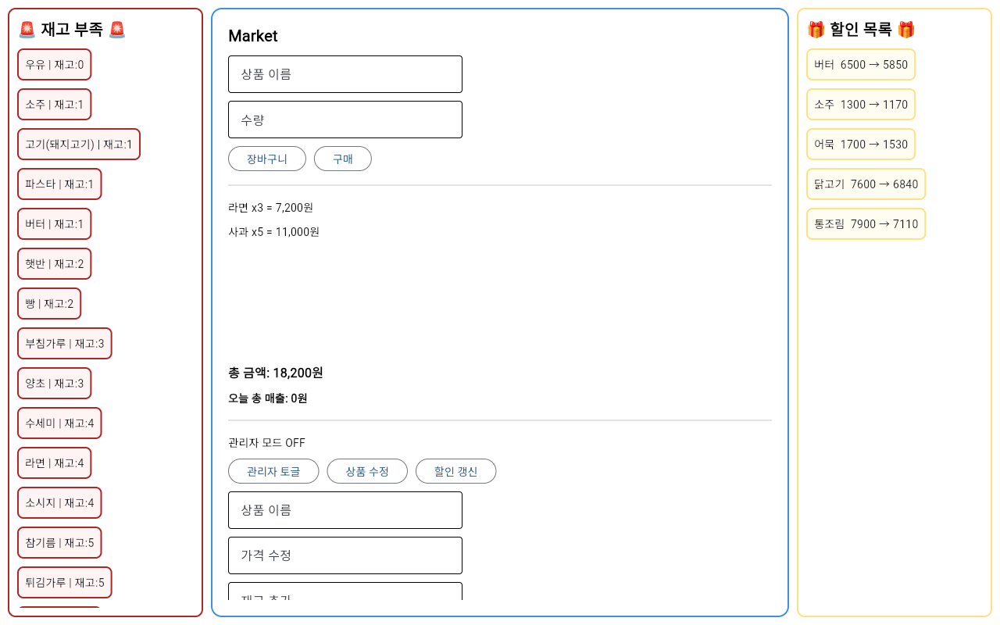 

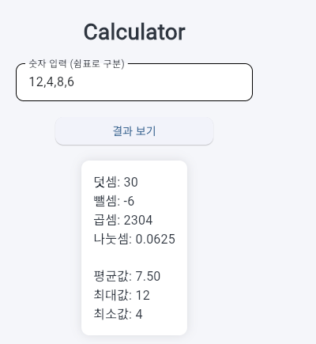 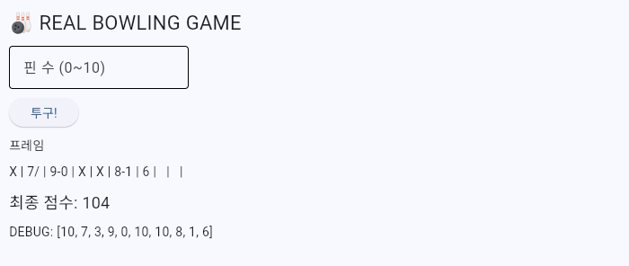

### 게임과 tkinter

| 프로그램 | 내용 |
|---|---|
| [볼링 점수 계산](Practice/README.md#볼링-점수-계산) | 스트라이크·스페어 보너스와 10프레임 규칙. 콘솔판에서 Flet판까지 작성본별 변경 정리 |
| [숫자 맞히기 게임](Practice/README.md#숫자-맞히기-게임) | 기회 제한과 재시작. 콘솔판에서 Flet판까지 작성본별 변경 정리 |
| [가위바위보](Practice/README.md#가위바위보) | Flet 화면, 3점 선승 세트제 |
| [로또 번호 추첨](flet/README.md#로또-번호-추첨) | 입력 검사와 집합 교집합으로 등수 판정하는 콘솔 프로그램 |
| [tkinter 위젯](Python%20GUI/README.md#1-tkinter-위젯) | Button, Checkbutton, Listbox, Scale, Scrollbar 등 위젯별 옵션과 이벤트 |

실행 화면

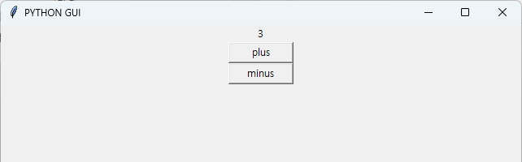 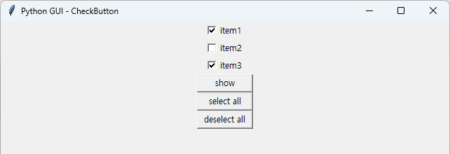

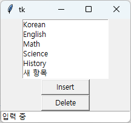 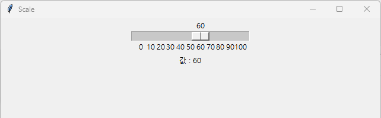

## 5. 확률 시뮬레이션

[가챠 확률 시뮬레이터](Practice/README.md#가챠-확률-시뮬레이터): 뽑기 획득 개수의 분포를 몬테카를로 시뮬레이션으로 계산하고 이항분포 계산값과 비교.

실행 결과

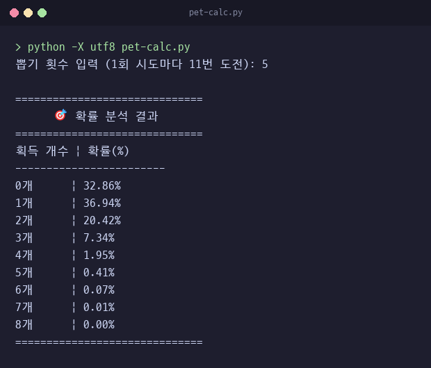

## 6. 기초 문법

[기초 문법](Practice/README.md#4-기초-문법): 변수 범위, 조건문, 반복문, 형변환, 함수, 파일 입출력.

---

## 실행 환경

- 콘솔 프로그램: Python 3.10, `python -X utf8 파일명`
- Flet 화면: Python 3.14, Flet 0.82.2
- 폴더별 실행 방법은 각 폴더 README에 정리
- [`README_FLET_PRESENTATION.md`](README_FLET_PRESENTATION.md)는 Flet 시각화판과 `flet` 폴더 응용 프로그램 발표 자료
