# Python 기본기 저장소

자료구조와 알고리즘을 파이썬 리스트와 클래스만으로 직접 구현한 학습 저장소.
`collections`·`heapq`·`queue` 같은 표준 자료구조 모듈 미사용.

| 구분 | 위치 | 내용 |
|---|---|---|
| 자료구조 직접 구현 | `MakeListSet/` | 리스트·스택·큐·덱·우선순위 큐·집합 13개 파일 |
| 응용 프로그램 | `MakeListSet/` | 괄호 검사, 수식 계산기, 미로 탐색 3종, 라인 편집기 |
| 시각화판 | `MakeListSet/*_flet.py` | 미로 탐색 3종, 수식 계산기, 라인 편집기의 Flet 화면판 |
| 정렬 | `Practice/고급정렬.py` | 셸·힙·병합·퀵·이중 피벗 퀵·기수 정렬 6종 |
| 그래프 | `Practice/graph.py` | 인접 리스트 기반 무방향 그래프 |
| 기타 실습 | `Practice/`, `flet/`, `Python GUI/`, `Flask/` | 볼링 점수 계산, 게임, GUI 위젯, 상점 관리 등 |

이 문서의 콘솔 결과는 모두 Python 3.10에서 `python -X utf8`로 직접 실행한 출력.
화면 캡처는 Flet 0.82.2 웹 모드 실행 화면.

---

## 1. 자료구조 직접 구현

같은 추상 자료형을 배열 방식과 연결 방식으로 각각 구현해 차이 비교.
배열 방식은 고정 크기 리스트와 인덱스 계산, 연결 방식은 `Node` 클래스와 참조 연결.

| 파일 | 구조 | 핵심 연산 | 구현 방식 |
|---|---|---|---|
| `리스트_배열.py` | 배열 리스트 | insert, delete, getEntry, find, replace, sort, append | 크기 10 고정 배열. 삽입 시 뒤 원소를 한 칸씩 뒤로, 삭제 시 앞으로 이동. 정렬은 버블 정렬 |
| `리스트_연결.py` | 단순 연결 리스트 | insert, delete, get_entry, find, replace, sort, merge, append | `data`·`next` 노드. `size` 변수로 개수 관리. 범위 밖 위치는 `IndexError` 발생 |
| `연결리스트_클래스.py` | 단순 연결 리스트 | 위와 동일 | `data`·`link` 노드. 위치 탐색을 `_get_node` 하나로 공용화. 개수는 매번 순회로 계산 |
| `스택_배열.py` | 배열 스택 | push, pop, peek, isfull, isempty | 크기 10 고정 배열. `size`가 top 위치 역할 |
| `연결스택_클래스.py` | 연결 스택 | push, pop, peek | 새 노드를 기존 top 앞에 연결. 가득 참 검사는 항상 False |
| `선형큐_클래스.py` | 선형 큐 | enqueue, dequeue, peek, size | front·rear가 -1에서 시작해 한 방향으로만 증가. rear가 배열 끝에 닿으면 앞쪽이 비어 있어도 가득 참 처리 |
| `원형큐_클래스.py` | 원형 큐, 연결 큐 | enqueue, dequeue, peek, size | `rear = (rear + 1) % capacity`, `front = (front + 1) % capacity` 모듈러 연산. 한 칸을 비워 공백과 포화 구분 |
| `연결큐_클래스.py` | 연결 큐 | enqueue, dequeue, peek, size | front·rear 두 노드 참조. 마지막 노드 삭제 시 rear도 None 처리 |
| `선형덱_클래스.py` | 선형 덱 | add_front, add_rear, delete_front, delete_rear, get_front, get_rear | 선형 큐 방식. 앞쪽 빈칸은 delete_front 이후에만 생기며, front가 -1이면 앞쪽 추가 거부 |
| `원형덱_클래스.py` | 원형 덱 | add_front, add_rear, delete_front, delete_rear, get_front, get_rear | `원형큐_클래스.ArrayQueue` 상속. is_full·is_empty·size·clear는 부모 메서드 재사용. 뒤로 이동은 `(x - 1 + capacity) % capacity` |
| `우선순위큐_클래스.py` | 우선순위 큐 | `enqueue(e, priority)`, dequeue, peek | 삽입 시점에 정렬 상태 유지. 숫자가 작을수록 우선. 같은 우선순위는 먼저 들어온 순서 유지 |
| `집합_배열.py` | 배열 집합 | insert, delete, union, intersect, difference, equals | 삽입 시 중복 검사. 삭제 시 뒤 원소를 당겨 빈칸 제거. 합집합 결과 배열은 두 집합 최대 크기의 합으로 확장 |
| `집합_연결.py` | 연결 집합 | contain, insert, delete, isempty | 머리 삽입 방식. union은 빈 집합만 반환하는 미구현 상태. intersect, difference, equals, size, display, isfull 미구현 |
| `Practice/graph.py` | 무방향 그래프 | insertVertex, insertEdge, deleteVertex, deleteEdge, degree, adjacent | 정점 집합과 인접 리스트 딕셔너리. 간선을 양쪽 정점에 모두 기록하고 간선 수는 합계의 절반 |

### 실행으로 확인한 동작

- 원형 큐: 용량 5에 6개 삽입 시 4개만 저장, 나머지 2회 overflow. 두 번 꺼낸 뒤 다시 넣으면 rear가 배열 끝을 지나 인덱스 0, 1로 순환
- 선형 큐: 용량 3을 채운 뒤 하나를 꺼내도 추가 거부. 원형 큐가 필요한 이유 확인
- 우선순위 큐: `환자C 3, 환자A 1, 환자D 3, 환자B 2` 순서 삽입 결과 `[환자A(p1), 환자B(p2), 환자C(p3), 환자D(p3)]`
- 원형 덱: `원형큐_클래스.py`를 import하는 순간 그 파일의 테스트 출력이 먼저 실행됨. 테스트 코드가 `if __name__ == "__main__":` 밖에 있기 때문
- 그래프: 정점 A·B·C·D, 간선 A-B·A-C·B-D에서 간선 수 3, A의 차수 2. A 삭제 후 간선 수 1
- `스택_배열.py`, `연결스택_클래스.py`, `집합_연결.py`는 테스트 코드가 없어 단독 실행 시 출력 없음

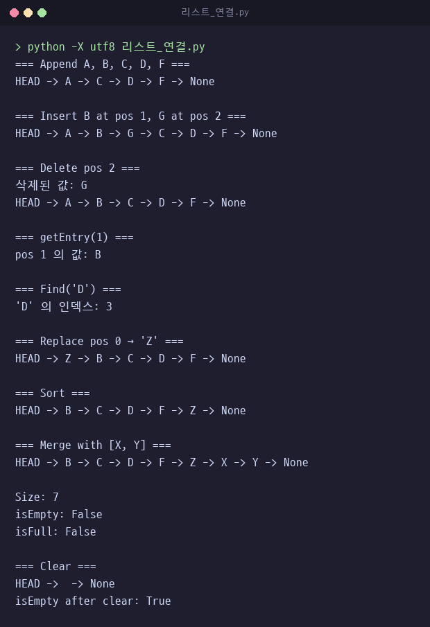

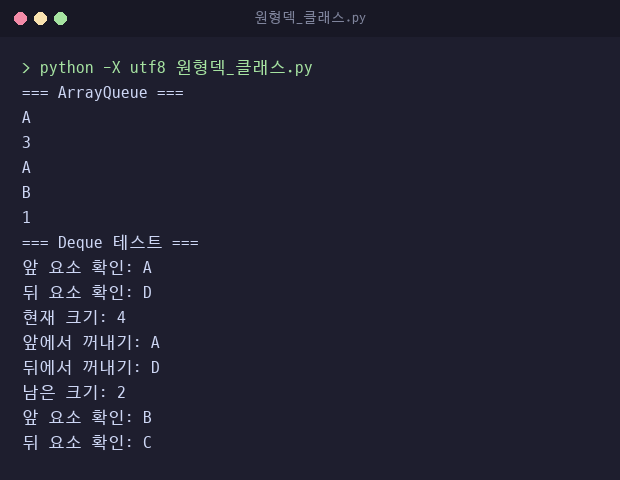 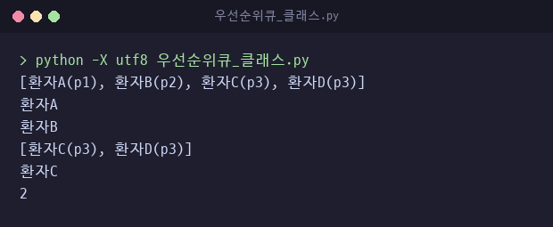

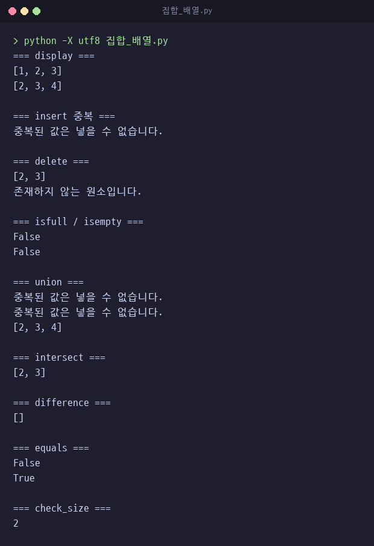

### 결함 수정 이력

커밋 `0f7ef6d`에서 실행 중 발견한 결함 4건 수정.

| 파일 | 결함 | 수정 |
|---|---|---|
| `리스트_연결.py` | is_empty·is_full·size_of의 `return` 누락으로 항상 None 반환 | 반환값 추가 |
| `선형덱_클래스.py` | front가 -1일 때 앞쪽 추가 시 `queue[-1]`, 즉 배열 마지막 칸에 기록 | front가 -1이면 추가 거부 |
| `집합_배열.py` | 삭제 자리에 None이 남고 마지막 원소가 유효 범위 밖으로 빠짐 | 뒤 원소를 한 칸씩 당겨 빈칸 제거 |
| `미로탐색_깊이우선.py` | 방문한 모든 칸을 경로로 출력해 막다른 칸까지 경로에 포함 | 칸마다 이전 칸을 기록하고 출구에서 거슬러 올라가 경로만 복원 |

---

## 2. 응용 프로그램

직접 구현한 스택·큐·우선순위 큐 개념을 실제 문제에 적용한 프로그램.

### 괄호 검사 `괄호검사.py`

여는 괄호는 스택에 넣고, 닫는 괄호가 나오면 스택 맨 위와 짝을 비교.
문자열 끝에서 스택이 비어 있어야 정상.
함수만 정의된 파일이라 아래 결과는 함수를 직접 호출해 확인.

| 입력 | 결과 |
|---|---|
| `{ A[ (i+1) ]=0; }` | OK |
| `A( (i+1] )=0;` | ERROR |
| `((` | ERROR |
| `)(` | ERROR |

### 수식 계산기 `수식계산기.py`

중위 표기식을 후위 표기식으로 바꾼 뒤 스택으로 계산.

- `infix_to_postfix`: 연산자 우선순위 `* /` 2, `+ -` 1. 스택 맨 위 연산자의 우선순위가 같거나 높으면 먼저 꺼내 출력
- `evaluate_postfix`: 숫자는 스택에 넣고, 연산자가 나오면 두 개를 꺼내 계산
- `evaluate_infix`: 두 메서드 연결
- `check_brackets`: 괄호 검사와 같은 스택 방식

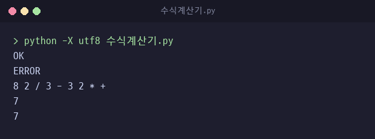

한계
- 토큰을 공백으로 구분. `(1+2)*3`처럼 붙여 쓰면 `IndexError` 발생
- 정수만 처리하며 나눗셈은 `int(a / b)`로 소수점 이하 버림. `7 / 2` 결과 3

### 미로 탐색 3종 비교

같은 6×6 미로, 시작 `(1, 0)`, 출구 `(3, 5)`에서 탐색 방식만 바꿔 비교.
`(1, 4)`와 `(2, 1)`은 막다른 칸.

| 파일 | 방식 | 사용 구조 | 방문 칸 수 | 경로 |
|---|---|---|---|---|
| `미로탐색_깊이우선.py` | 깊이 우선 탐색 | 리스트 스택. `(현재 칸, 이전 칸)` 쌍 저장 | 9 | 8칸. 이전 칸 기록으로 복원 |
| `미로탐색_너비우선.py` | 너비 우선 탐색 | 리스트 큐 `pop(0)`. 큐에 넣는 시점에 방문 처리 | 10 | 8칸 최단 경로. 부모 딕셔너리로 복원 |
| `미로탐색_전략적.py` | 우선순위 탐색 | 직접 만든 정렬 리스트 우선순위 큐. 출구까지 거리 제곱이 우선순위 | 8 | 방문 순서만 출력, 경로 복원 없음 |

실행 결과 비교
- 깊이 우선: 상하좌우 순서로 넣고 마지막에 넣은 오른쪽부터 꺼내므로 `(1, 4)` 막다른 칸에 먼저 들어간 뒤 되돌아옴. 최종 경로에서는 제외
- 너비 우선: 시작점과 가까운 칸부터 퍼지므로 `(2, 1)`과 `(1, 4)` 두 막다른 칸 모두 방문. 대신 최단 경로 보장
- 우선순위: 거리 29, 20, 13, 8, 5, 4, 1, 0 순서로 출구에 가까운 칸만 골라 이 미로에서는 막다른 칸 방문 없음. 거리 계산에 벽은 미반영

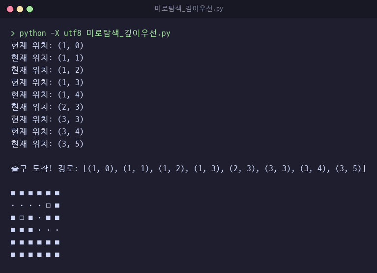

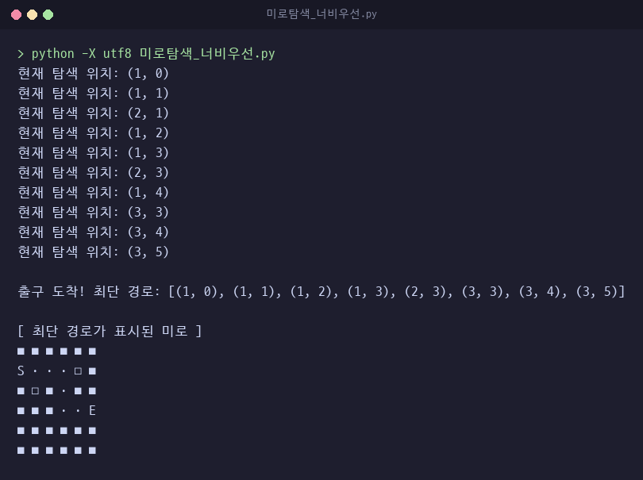

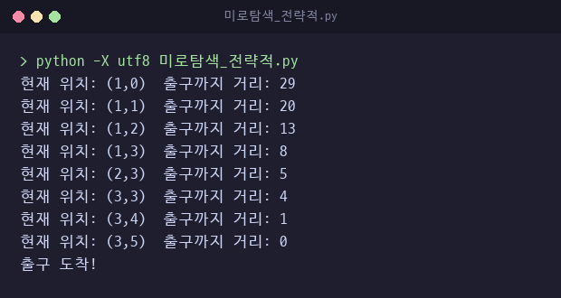

### 라인 편집기 `라인편집기.py`

줄 번호 기반 텍스트 편집기. 줄 목록을 리스트로 관리하고 슬라이싱으로 삽입·삭제.

| 명령 | 동작 |
|---|---|
| `i(줄, 내용)` | 해당 줄에 삽입 |
| `d(줄)` | 해당 줄 삭제 |
| `r(줄, 내용)` | 해당 줄 교체 |
| `p()` | 전체 출력 |
| `s()`, `l()` | `text.txt` 저장, 불러오기 |
| `q()` | 종료 |

- 실행 위치에 `text.txt`를 만들거나 덮어씀
- 줄 끝 개행 문자를 내용에 포함해 저장하므로 `p()` 출력에서 줄 사이에 빈 줄이 하나씩 추가로 표시됨

---

## 3. 정렬 6종 `Practice/고급정렬.py`

비교 기반 정렬 5종과 비교 없는 기수 정렬 1종 구현.

| 함수 | 정렬 | 구현 방식 |
|---|---|---|
| `shell_sort` | 셸 정렬 | 간격을 n//2부터 절반씩 줄이며 간격 단위 삽입 정렬. 원본 리스트를 직접 정렬 |
| `heap_sort` | 힙 정렬 | 최대 힙 구성 후 루트를 끝으로 보내고 재귀 heapify 반복 |
| `merge_sort` | 병합 정렬 | 절반씩 재귀 분할 후 병합. 같은 값은 왼쪽 우선으로 순서 유지 |
| `quick_sort` | 퀵 정렬 | 가운데 원소를 피벗으로 작은 값·같은 값·큰 값 세 리스트로 분할. 새 리스트 생성 방식 |
| `double_quick_sort` | 이중 피벗 퀵 정렬 | 첫 원소와 마지막 원소를 두 피벗으로 다섯 구간 분할 |
| `radix_sort` | 기수 정렬 | 일의 자리부터 자릿수마다 버킷 10개에 분배 후 순서대로 합침 |

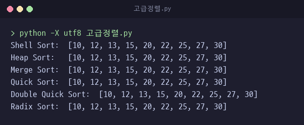

검증
- 0~999 정수, 길이 0~40의 무작위 배열 500개를 `sorted()` 결과와 비교
- 셸·힙·병합·퀵·기수 정렬 5종은 500개 모두 일치
- 이중 피벗 퀵 정렬은 26개 불일치. 두 피벗 값이 같으면 같은 값이 두 구간에 중복 포함됨. 예: `[5, 1, 5]` 결과 `[1, 5, 5, 5, 5]`
- 기수 정렬은 음수 미지원. `[3, -1, 2]` 결과 `[2, 3, -1]`

---

## 4. 시각화판 `MakeListSet/*_flet.py`

콘솔 알고리즘을 Flet 화면으로 옮겨 탐색 과정과 결과를 눈으로 확인하도록 만든 판.

| 파일 | 내용 |
|---|---|
| `미로탐색_깊이우선_flet.py` | 탐색 중인 칸 노란색, 지나간 칸 파란색. `asyncio.sleep(0.3)`으로 한 칸씩 표시. 탐색 중 버튼 비활성화 |
| `미로탐색_너비우선_flet.py` | 같은 화면에 너비 우선 탐색 적용. 출구 도착 시 최단 경로를 진한 파란색으로 다시 표시 |
| `미로탐색_전략적_flet.py` | 같은 화면에 거리 기반 우선순위 탐색 적용. 상단에 현재 칸의 출구까지 거리 표시 |
| `수식계산기_flet.py` | 숫자·연산자·괄호 버튼과 직접 입력 지원. 괄호 오류와 수식 오류를 구분해 표시 |
| `라인편집기_flet.py` | 줄 번호와 내용 입력 후 삽입·수정·삭제·저장·불러오기. 줄 번호 범위 검사와 파일 없음 처리 |

깊이 우선 탐색 진행 중, 완료

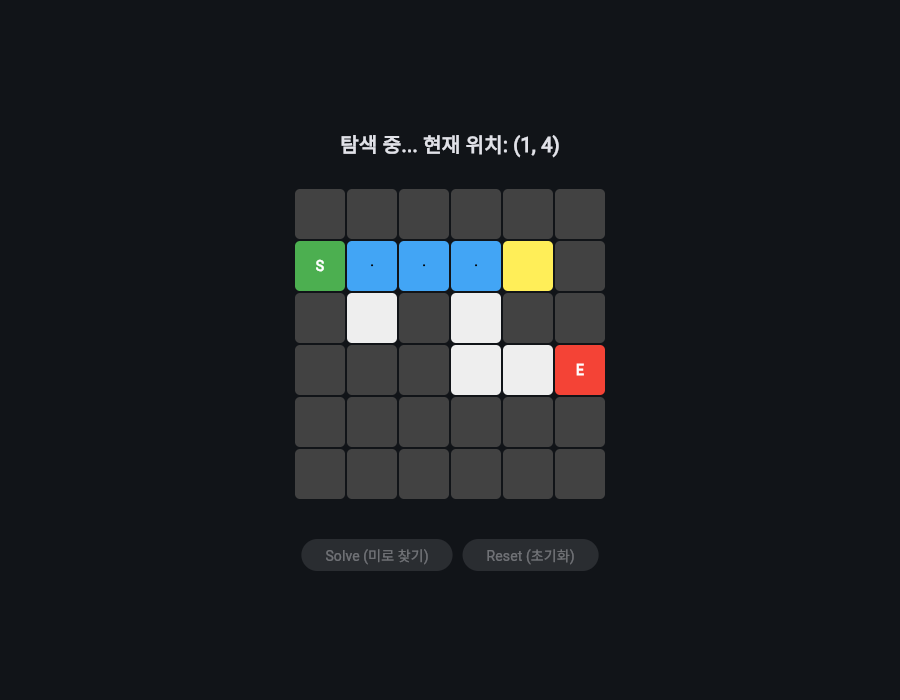 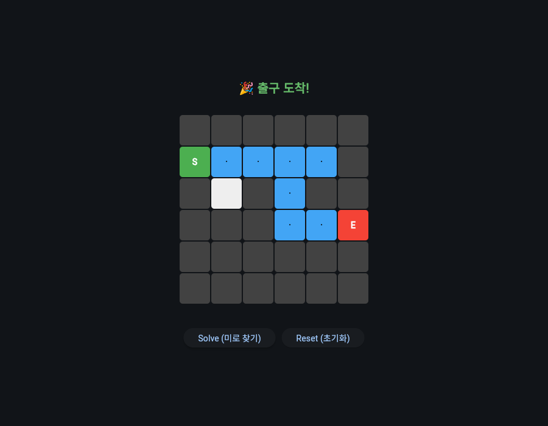

우선순위 탐색 완료

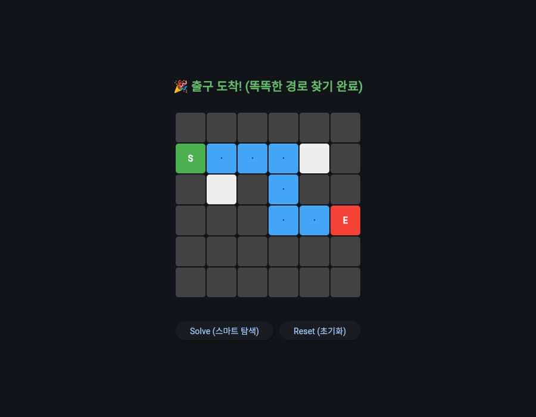

수식 계산기, 라인 편집기

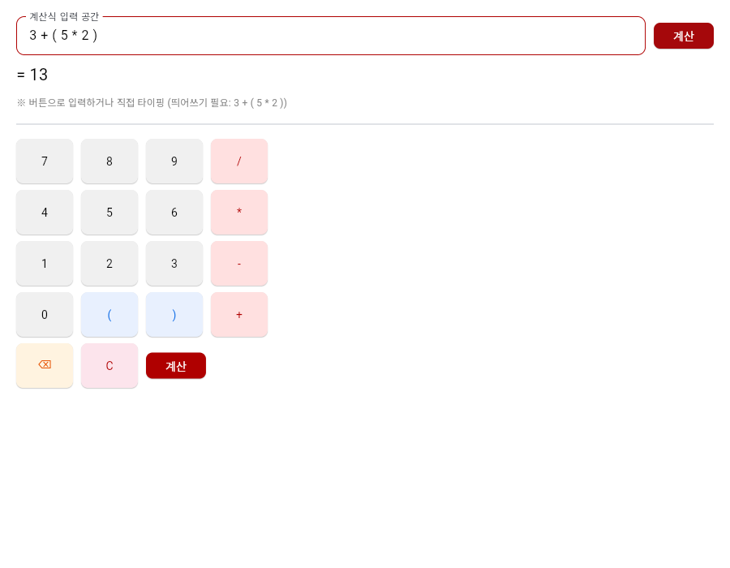 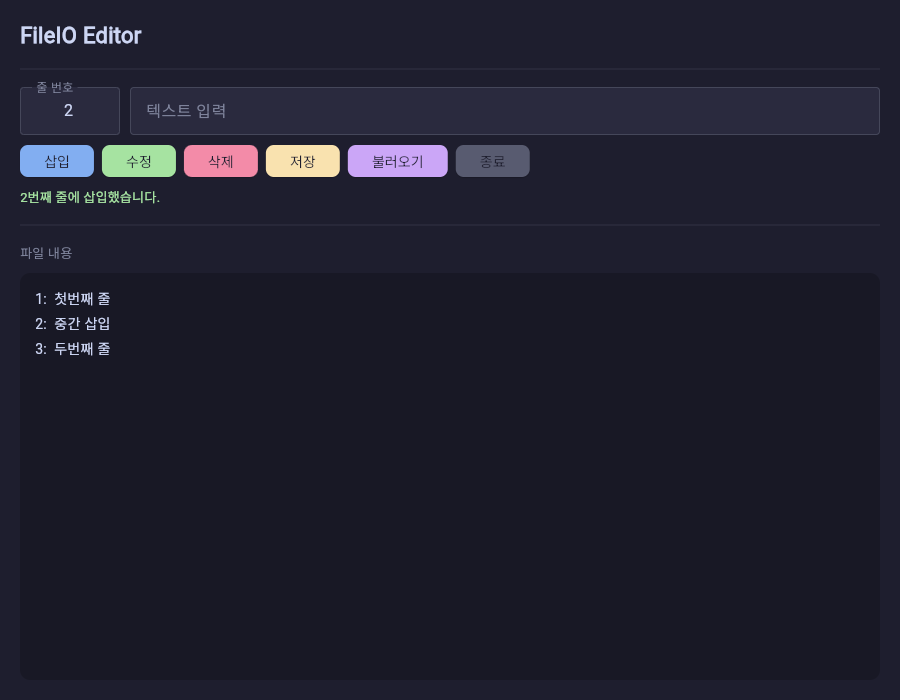

확인된 차이와 한계
- 깊이 우선 시각화판은 `0f7ef6d`의 경로 복원 수정 전 방식. 방문한 칸을 모두 파란색으로 표시하므로 막다른 칸 `(1, 4)`도 경로처럼 보임
- 너비 우선 시각화판은 Flet 0.82.2에 `ft.alignment.center` 속성이 없어 화면 생성 단계에서 오류 발생
- 수식 계산기 버튼은 누를 때마다 값 뒤에 공백을 붙임. 1과 2를 연속으로 누르면 12가 아닌 `1 2` 두 토큰이 되므로 여러 자리 수는 직접 입력 필요

---

## 5. 기타 실습 폴더

| 폴더 | 주요 파일 | 내용 |
|---|---|---|
| `Practice/` | `bowling.py`, `BowlingGame.py`, `bowling_func.py`, `bowling_final.py`, `bowling_automation.py` | 볼링 점수 계산 콘솔 작성본. 스트라이크·스페어 보너스와 10프레임 규칙, 투구마다 전광판 갱신 |
| | `Bowling_flet.py`, `Bowlingfletcomplete.py`, `Bowlingfletcomplete_class.py`, `bowling2.py` | 볼링 점수 계산의 Flet 화면판과 투구 유효성 검사 |
| | `UPDOWN_1.py` ~ `UPDOWN_5.py`, `UPDONW_2.py` | 1~100 숫자 맞히기 게임. 콘솔·tkinter·Flet 작성본, 기회 제한과 재시작 |
| | `RSP.py` | Flet 가위바위보. 3점 선승으로 세트 획득, 3세트 선승으로 종료 |
| | `Calculator.py` | tkinter 입력창 계산기 |
| | `Test.py` ~ `Test4.py`, `write.py`, `errortest.py` | 변수 범위, 조건문, 반복문, 함수, 파일 입출력, Flet 버튼 기초 연습 |
| | `pet.py`, `pet-calc.py` | 뽑기 확률 시뮬레이터. 6절 참고 |
| `flet/` | `market.py` | 상점 관리 화면. `market.json` 재고·가격 저장, 무작위 5개 상품 10% 할인, 재고 5개 이하 경고, 관리자 모드, `receipt.txt` 영수증 기록 |
| | `import random.py` | 같은 상점 화면의 다른 작성본 |
| | `Call.py` | 전화번호부. `people.csv` 저장, 추가·수정·삭제·검색 |
| | `calculator_flet.py` | 여러 숫자의 합·차·곱·나눗셈·평균·최댓값·최솟값 계산 |
| | `flet_bowling.py`, `flet_title.py`, `Text.py` | 볼링 화면, 라벨 겹침 상자 배치 연습, 음향 분석 모니터 화면 구성 연습 |
| | `import random as rand.py` | 1~43 번호 6개 입력 후 무작위 추첨과 비교하는 로또 콘솔 프로그램 |
| | `Text2.py`, `PYTHON GUI EXAMPLE.py` | tkinter 기초 |
| `Python GUI/` | `CheckButton.py`, `Frame.py`, `GUIBUTTON.py`, `Listbox*.py`, `Message.py`, `Scale.py`, `Scrollbar.py` | tkinter 위젯별 연습 |
| | `RSPQuiz.py` | 콘솔 가위바위보. 5회 제한, 3점 선승 |
| `Flask/` | `app.py` | `/` 경로에 Hello, World! 응답 하나만 있는 Flask 시작 예제 |

`README_FLET_PRESENTATION.md`는 Flet 시각화판과 `flet/` 응용 프로그램 발표 자료.

---

## 6. 가챠 확률 시뮬레이터 `Practice/pet-calc.py`

게임 뽑기에서 특정 아이템을 몇 개 얻을지의 확률 분포를 몬테카를로 시뮬레이션으로 계산하는 프로그램.

제작 목적
- 몇 번 뽑으면 몇 개 정도 얻는지 직관적으로 확인
- 확률이 낮은 이벤트에서 체감 확률과 실제 확률의 차이 확인

작동 방식
- 1회 뽑기 = 11번 시도
- 시도마다 2% 확률로 당첨
- 입력한 횟수 n에 대해 총 `11 × n`번 시도
- 이 과정을 1,000,000번 반복해 획득 개수별 비율 계산
- 최대 8개까지 집계

결과 해석
- 각 값은 해당 개수를 얻을 확률
- 기댓값뿐 아니라 운이 좋거나 나쁠 확률까지 분포로 확인 가능
- n = 5 실행 결과 0개 32.86%. 55번 모두 실패할 이론값 0.98⁵⁵ ≈ 32.9%와 일치

핵심 코드

```python
import random

trials = 1000000
max_pet = 8 #최대 계산하는 당첨 마릿수
single_prob = 0.02 #뽑기 당첨 확률

# 11회 뽑기 횟수 입력
n = int(input("뽑기 횟수 입력 (1회 시도마다 11번 도전): "))

counts = [0] * (max_pet + 1)

for _ in range(trials):
    pets = 0

    # 총 뽑기 횟수 = 11 * n
    for _ in range(n * 11):
        if pets < max_pet and random.random() < single_prob:
            pets += 1

    counts[pets] += 1

# 확률 계산
probabilities = [c / trials * 100 for c in counts]
```

실행 결과, n = 5

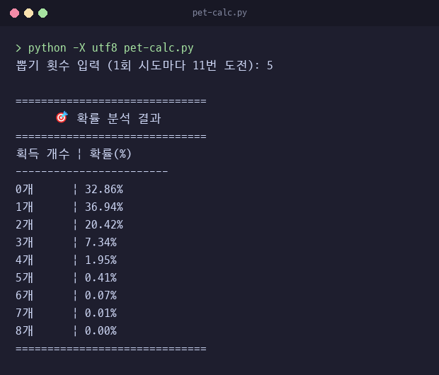

기존 실행 화면


`Practice/pet.py`는 5회·11회·44회 뽑기를 이어서 진행할 때 최대 3개까지의 획득 수를 기록하는 실험본.

사용 기술: Python, `random` 모듈, 몬테카를로 시뮬레이션

---

## 7. 실행 방법

콘솔 프로그램

```bash
cd MakeListSet
python -X utf8 원형큐_클래스.py
python -X utf8 미로탐색_너비우선.py

cd ../Practice
python -X utf8 고급정렬.py
python -X utf8 pet-calc.py
```

- 한글 출력 깨짐 방지를 위해 `-X utf8` 사용
- `원형덱_클래스.py`는 `원형큐_클래스.py`를 import하므로 `MakeListSet` 폴더 안에서 실행
- `라인편집기.py`는 실행 위치의 `text.txt`를 덮어씀
- `pet-calc.py`는 반복 횟수가 많아 n = 5 기준 약 13초 소요

Flet 시각화판

```bash
pip install flet==0.82.2
cd MakeListSet
python 미로탐색_깊이우선_flet.py
```

- 확인 환경: Python 3.14, Flet 0.82.2
- `ElevatedButton`은 Flet 0.80부터 사용 중단 예고 경고 출력
